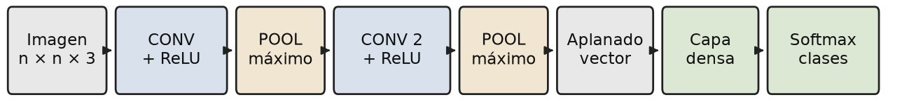
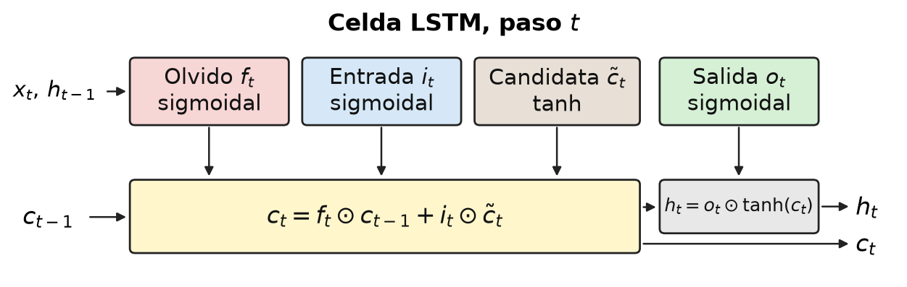
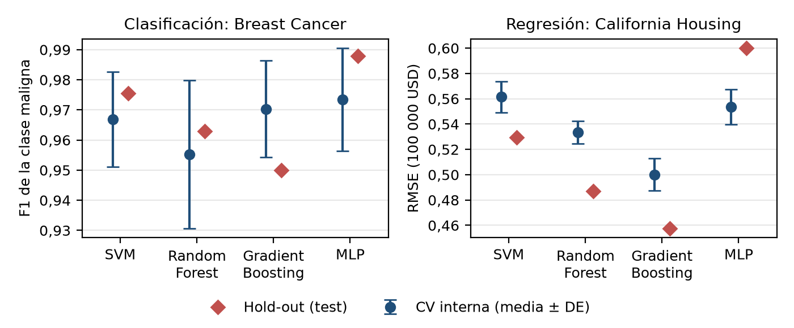
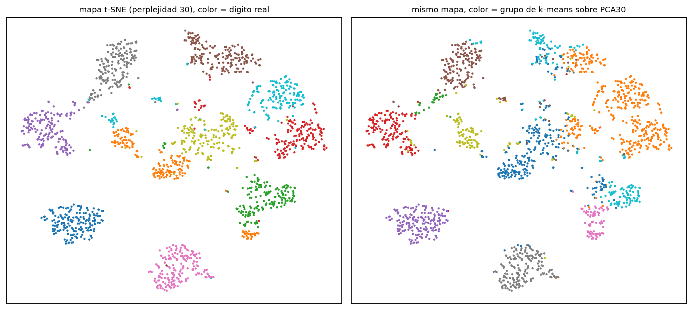

<!-- PORTADA grupal: nombres en la misma hoja del título (via apptocmd maketitle).
     Sin campo author: en el YAML. -->

```{r setup, include=FALSE}
# Locale C imprime ó como el texto literal <U+00F3> en kable y en fig.cap.
Sys.setlocale("LC_ALL", "en_US.UTF-8")
library(knitr)
library(kableExtra)

knitr::opts_chunk$set(
  echo      = FALSE,
  warning   = FALSE,
  message   = FALSE,
  fig.pos   = "H",
  out.width = "42%",
  fig.align = "center"
)
```

<!-- ============================================================================
     CONSIGNA GENERAL (transcripta del PDF del examen)

     - Grupos de hasta 4 alumnos. Es valido el examen individual.
     - Entrega: antes del 5 de octubre de 2026, en un archivo PDF.
     - Se debe detallar la fuente de cada respuesta.
     - No mas de 4 hojas por pregunta.
     - Portada con los nombres de los miembros del grupo.
     - El profesor puede pedir a cualquier integrante una explicacion adicional.
     - Rigor en las expresiones y en las descripciones.
     - La nota se normaliza en funcion del mejor examen.

     CRITERIOS DE DETECCION DE USO INADECUADO DE LLM
     - Inconsistencias entre secciones del trabajo.
     - Terminologia muy avanzada sin comprension demostrable.
     - Codigo perfecto sin comentarios personales.
     - Referencias irrelevantes o inexistentes.
     - Estilo de escritura inconsistente.

     PENALIZACIONES POR ESTILO ARTIFICIAL
     - -20 % por respuesta que use jerga tecnica sin explicar.
     - -30 % por respuesta que no muestre proceso de razonamiento personal.
     - -50 % por respuesta que parezca generada automaticamente.
     ============================================================================ -->

# Ejercicio 1 · Redes neuronales

## Punto I

*Explique el papel de las funciones de activación en redes neuronales profundas.
Discuta por qué son necesarias, cómo afectan la capacidad de representación y cuáles
son sus ventajas y desventajas más importantes.*

La combinación agrega las entradas ponderadas, $w_0 + w_1 x_1 + \dots + w_k x_k$, y la
activación transforma esa suma en la salida de la neurona (Volpacchio, s.f.). Sin no
linealidad, dos capas colapsan a $W_2(W_1 x)=(W_2 W_1)x$ y la red entera no representa
más que una regresión lineal. Con activación sigmoidal, una capa oculta con suficientes
neuronas aproxima cuanto se quiera cualquier función continua sobre una región cerrada
y acotada (Cybenko, 1989).

Las activaciones más comunes son el escalón, la sigmoide, tanh, softmax y ReLU,
$\max(0, z)$, la más usada en redes profundas (Goodfellow et al., 2016). El escalón da salida binaria, pero su
derivada es nula (salvo en 0, donde no existe) y no sirve para entrenar por gradiente.
La sigmoidal, con rango $(0, 1)$, se lee como probabilidad; tanh, con rango $(-1, 1)$,
está centrada en cero. Ambas saturan: lejos del origen la derivada es casi nula y su
producto capa tras capa tiende a cero (desvanecimiento del gradiente). Softmax da
probabilidades que suman 1; en clasificación va en la salida. ReLU no satura para
$z > 0$, pero una neurona que recibe siempre $z < 0$ muere: deja de actualizarse.

## Punto II

*Describa el proceso de entrenamiento de una red neuronal (forward pass, función de
pérdida, backpropagation, optimización). Analice conceptualmente qué factores
determinan la calidad del aprendizaje. Explique las diferencias esenciales entre redes
"Deep" y "Shallow".*

El entrenamiento busca los pesos que minimizan el error (Volpacchio, s.f.). En el
forward pass cada neurona combina y activa, capa por capa, hasta la predicción $o$; la
pérdida compara $o$ con el objetivo $t$ (error cuadrático, o menos el logaritmo de la
probabilidad de la clase correcta). Backpropagation obtiene por regla de la cadena,
desde la salida, $\delta_j = \partial E / \partial \text{net}_j$, la derivada de la
pérdida respecto de la entrada combinada de cada neurona. La optimización mueve cada
peso contra el gradiente, $w_{ji} \leftarrow w_{ji} - \eta\,\delta_j\,o_i$ ($o_i$:
salida que alimenta a $j$; $\eta \in (0, 1)$: tasa de aprendizaje), tras cada
observación (online), tras cada época (batch) o tras lotes chicos.

La calidad depende de los datos frente a la cantidad de pesos, de $\eta$ (chica no
avanza, grande oscila), de los mínimos locales y del criterio de corte. Contra el
sobreajuste, el apunte de taxonomía de la clase 4 agrupa early stopping (cortar cuando
sube el error de validación), weight decay y dropout como formas de la misma idea,
restringir la familia de funciones. Una red superficial (shallow) tiene una sola capa
oculta. Una profunda (deep) apila capas que arman rasgos sobre rasgos (bordes, formas,
objetos) con pocas neuronas por capa; pide más datos y el gradiente se desvanece más,
lo que motivó ReLU y las conexiones residuales (Goodfellow et al., 2016).

## Punto III

*Explique el concepto de "embedding" y autoencoder en el contexto de "Deep Learning".
De ejemplos de uso.*

Los dos están en el material de la clase 4: `autoencoders.pdf` desarrolla el
autoencoder completo, con el cuello de botella y los tipos convolucional, sparse,
profundo y contractivo, y el apunte de taxonomía marca los autoencoders como vistos en clase y
dedica una subsección a los word embeddings. Un embedding es un
vector denso y corto que representa un objeto discreto (palabra, producto, cliente) y
que la red aprende como un peso más: word2vec lo aprende para cada palabra a partir de
sus vecinas, y palabras de contextos parecidos quedan próximas (Mikolov et al., 2013).
Un autoencoder reconstruye su entrada: el encoder comprime a un código de menor
dimensión (el cuello de botella), el decoder reconstruye y la pérdida es el error de
reconstrucción, sin etiquetas. Usos: reducción de dimensión no lineal (Hinton &
Salakhutdinov, 2006), anomalías (lo que se reconstruye mal) y eliminación de ruido.

## Punto IV

*De un tipo de red neuronal que sirve para obtener clustering. La que elija, explique
brevemente cómo funciona.*

Se elige el SOM (Self Organizing Map, mapa autoorganizado) del apunte; k-means y
DBSCAN no son redes, y el competitive learning (neuronas que compiten sin relación de
vecindad) agrupa pero no ordena el mapa (Kohonen, 1990; Volpacchio, s.f.). Cada
neurona $U_j$ de la grilla tiene pesos $w_j$ de la dimensión de la entrada. Para cada
$x$, la ganadora $U_{win}$ minimiza $\lVert x - w_j \rVert$ y se actualiza
$w_j(t) = w_j(t-1) + (x - w_j)\,\eta(t)\,N_{win}(j,t)$: el entorno $N_{win}$ se achica
hasta la ganadora y la tasa $\eta(t)$ achica el paso. Cada neurona queda como
prototipo, cada observación va a su ganadora y las neuronas vecinas parecidas forman un
cluster.

## Punto V

*¿Qué es una convolución y como aplica en las redes neuronales? De un diagrama de las
distintas capas de una red convolucional y explique.*

Una convolución recorre un filtro, una matriz de pesos mucho más chica que la entrada,
sobre un mapa de píxeles; cada suma de productos forma un punto del mapa de
características. El *kernel* de las diapositivas de CNN es ese filtro, no el de SVM. Con lado
$n$, filtro $f$, relleno del borde (padding) $r$ y salto (stride) $s$, la salida mide
$\lfloor (n + 2r - f)/s \rfloor + 1$ (`deep_learning_CONV_Ng.pptx`; Volpacchio, s.f.).
LeCun et al. (1998) aprenden el filtro por backpropagation, con conexión local y pesos
compartidos: menos parámetros que una capa densa, y un rasgo desplazado produce la
misma respuesta desplazada (equivariancia a la traslación). El pooling por el máximo de
cada ventana agrega invariancia a corrimientos chicos. En la Figura 1, el aplanado
convierte los mapas en un vector, la capa densa combina los rasgos y softmax da la
probabilidad de cada clase.

```{r e1-cnn, out.width="75%", fig.cap="Capas de una CNN t\\'{\\i}pica de clasificaci\\'on de im\\'agenes."}

```

*Nota.* Elaboración propia a partir de `deep_learning_CONV_Ng.pptx` (Volpacchio, s.f.).

## Punto VI

*¿Qué es una red neuronal recurrente clásica? ¿Las redes LSTM en que se diferencian de
las redes recurrentes clásicas? De un diagrama de su topología y explíquela brevemente.
Cantidad de parámetros que utiliza en base a su configuración. Genere un ejemplo
completo en Python de aplicación de una red LSTM para predecir una serie de tiempo
arbitraria. Pruebe diferentes configuraciones de capas y cantidad de neuronas.*

```{r e1-load, include=FALSE}
e1lstm <- read.csv("codigo/resultados/e1/lstm_configs.csv", stringsAsFactors = FALSE)
e1runs <- read.csv("codigo/resultados/e1/lstm_runs.csv", stringsAsFactors = FALSE)
# meta.json se lee con base R para no sumar dependencias.
e1meta <- paste(readLines("codigo/resultados/e1/meta.json", warn = FALSE), collapse = " ")
e1m <- function(k) as.numeric(sub(paste0('.*"', k, '": *([0-9.eE+-]+).*'), "\\1", e1meta))
e1best_name <- sub('.*"best_by_val": *"([^"]+)".*', "\\1", e1meta)
e1best <- e1lstm[e1lstm$config == e1best_name, ]
fmt_e1 <- function(x, d = 4) formatC(as.numeric(x), format = "f", digits = d, decimal.mark = ",")
p32 <- e1lstm[e1lstm$config == "lstm_32", ]
p6432 <- e1lstm[e1lstm$config == "lstm_64_32", ]
una <- e1runs$config %in% c("lstm_32", "lstm_64")
pct_e1 <- function(x) paste0(round(100 * x), "\\thinspace{}%")
```

Una RNN (red recurrente) clásica, las Recurrent Networks del apunte (Volpacchio,
s.f.), reutiliza su estado, $h_t = f(W x_t + U h_{t-1} + b)$, con los mismos pesos en
cada paso; hacia atrás el gradiente se multiplica por $U$ una vez por paso y en
dependencias largas se desvanece o explota. La LSTM (Long Short-Term Memory), que el apunte
`Dimensiones y Arquitectura LSTM` de la clase 4 desarrolla puerta por puerta, agrega una
celda $c_t$ que se actualiza con una suma de lo nuevo y lo
anterior (Hochreiter & Schmidhuber, 1997) y una puerta de olvido (Gers et al., 2000).
En la Figura 2 ($s$: sigmoidal; $\odot$: producto elemento a elemento), cada puerta es
$g_t = s(W_g x_t + U_g h_{t-1} + b_g)$, $g \in \{f, i, o\}$: $f_t$ dosifica cuánto de
$c_{t-1}$ se conserva, $i_t$ cuánto de la candidata $\tilde c_t$ (tanh) se escribe y
$o_t$ cuánto sale en $h_t$; con $f_t \approx 1$ el gradiente cruza la celda.

```{r e1-lstm-topo, out.width="55%", fig.cap="Celda LSTM en un paso temporal."}

```

*Nota.* Elaboración propia. $x_t$ y $h_{t-1}$ alimentan las cuatro cajas superiores.

Con la fórmula de ese apunte,
$4 \times [(\text{units} \times \text{input\_dim}) + \text{units}^{2} + \text{units}]$
por capa (tres puertas y la candidata, cada una con $W$, $U$ y sesgo), `lstm_32` tiene
$4 \times [(32 \times 1) + 32^{2} + 32] = 4352$ parámetros, como `model.summary()`. El
script del Apéndice usa dos senos más ruido gaussiano de desvío
`r fmt_e1(e1m("noise_sd"), 1)`, ventanas de `r e1m("lookback")` valores,
`r e1m("epochs")` épocas con Adam (paso adaptado a cada peso), corte temporal 80/20
sin mezclar, el último 10\thinspace{}% del entrenamiento como validación y tres
semillas, porque con una el orden entre configuraciones podía ser azar.

```{r e1-lstm-tab}
tab_e1 <- data.frame(
  Config = e1lstm$config,
  Capas = e1lstm$layers,
  Formula = e1lstm$params_formula_lstm,
  Keras = e1lstm$params_keras,
  Val = fmt_e1(e1lstm$val_mae_mean),
  Test = paste0(fmt_e1(e1lstm$test_mae_mean), " ± ", fmt_e1(e1lstm$test_mae_sd))
)
names(tab_e1) <- c("Config", "Neuronas por capa", "Fórmula", "Total Keras", "MAE val.",
                   "MAE test")
kable(
  tab_e1,
  booktabs = TRUE,
  caption = "LSTM: parámetros y error (media de tres semillas).",
  format.args = list(decimal.mark = ",")
) %>%
  kable_styling(latex_options = "HOLD_position", position = "center", font_size = 9) %>%
  column_spec(1, width = "2cm") %>%
  column_spec(2, width = "1.8cm") %>%
  column_spec(3, width = "1.4cm") %>%
  column_spec(4, width = "1.6cm") %>%
  column_spec(5, width = "1.5cm") %>%
  column_spec(6, width = "2.9cm")
```

*Nota.* Elaboración propia. Fórmula: solo capas LSTM. MAE test: media ± DE entre semillas.

Gana por validación `r e1best_name` (`r fmt_e1(e1best$val_mae_mean)`); su MAE de test,
`r fmt_e1(e1best$test_mae_mean)`, mejora un
`r pct_e1(1 - e1best$test_mae_mean / e1m("persist_mae"))` a la persistencia (predecir
con el valor anterior, `r fmt_e1(e1m("persist_mae"))`) y queda un
`r pct_e1(e1best$test_mae_mean / e1m("floor_mae") - 1)` sobre el piso de ruido (señal
limpia contra observada, `r fmt_e1(e1m("floor_mae"))`). Dos capas validan peor en
todas las corridas (peor con una: `r fmt_e1(max(e1runs$val_mae[una]))`; mejor con dos:
`r fmt_e1(min(e1runs$val_mae[!una]))`). En test `lstm_64` gana por menos de un
desvío; se mantiene la elección, porque decidir con el test le quita valor de
estimación.

## Punto VII

*Describa el algoritmo encoder-decoder. Usos habituales.*

La arquitectura existe porque una red recurrente sola exige que la entrada y la salida
tengan el mismo largo, y traducir no funciona así. Son dos redes acopladas: el encoder
resume la secuencia de entrada en un vector de contexto y el decoder genera la salida de a
un elemento, realimentado con lo ya generado, hasta emitir el símbolo de fin
(Sutskever et al., 2014). El cuello de botella está en ese vector de contexto, que tiene
tamaño fijo y carga con la oración entera, de manera que el rendimiento se degrada cuanto
más larga es. La atención lo resuelve: deja al decoder consultar en cada paso todos los
estados del encoder en lugar de un único resumen (Bahdanau et al., 2015), y de ahí sale el
Transformer, que descarta la recurrencia y se queda solo con la atención (Vaswani et al.,
2017). Usos habituales: traducción automática, resumen de textos, reconocimiento de voz y
descripción automática de imágenes, donde el encoder es una red convolucional y el decoder
una recurrente. El autoencoder del Punto III es el caso particular en que la salida que se
pide es la propia entrada.

## Punto VIII

\setlength{\itemsep}{1pt}
\setlength{\parsep}{0pt}
\setlength{\topsep}{2pt}
\enlargethispage{2\baselineskip}

*Explique de qué manera la arquitectura de una red neuronal artificial influye en su
capacidad de representación y generalización.*

*Describa qué se entiende por capacidad de representación y por capacidad de
generalización en el contexto del aprendizaje automático.*

- *Analice cómo distintos elementos arquitectónicos (cantidad de capas, número de
  neuronas, funciones de activación, regularización, tipo de conexión, etc.) modifican
  estas capacidades.*
- *Discuta el rol del sesgo y la varianza en redes neuronales y cómo la arquitectura
  puede afectar este equilibrio.*
- *Incluya ejemplos conceptuales (no numéricos) que ilustren cuándo una red puede estar
  subajustada (underfitting) o sobreajustada (overfitting) por decisiones
  arquitectónicas.*
- *Fundamente cómo un cambio arquitectónico puede mejorar o empeorar el desempeño,
  incluso sin modificar los datos de entrenamiento.*
- *Reflexione sobre por qué modelos con más parámetros no siempre son mejores, y cómo
  esto se conecta con el principio de mínima complejidad y el aprendizaje profundo
  moderno.*

La capacidad de representación es el conjunto de funciones que la arquitectura computa
al variar sus pesos; la de generalización, sostener el desempeño en datos no vistos
(brecha entre error de entrenamiento y de validación; Volpacchio, s.f.). Más capas y
neuronas agrandan la primera si la activación es no lineal; weight decay, early
stopping y dropout (apagar neuronas al azar; Srivastava et al., 2014) la restringen.
La convolución supone rasgos locales repetidos, la recurrencia orden temporal y la
capa densa nada; las conexiones residuales (sumar la entrada de un bloque a su salida)
permiten entrenar más de cien capas (He et al., 2016).

Sesgo es la distancia entre la predicción promedio sobre las muestras posibles y el
valor verdadero; varianza, cuánto cambia el ajuste de una muestra a otra; el error
esperado suma sesgo al cuadrado, varianza y ruido. Un perceptrón sin capa oculta no
separa el XOR (clases en esquinas opuestas de un cuadrado) y subajusta: sesgo alto. Un
MLP (perceptrón multicapa) muy ancho, sin regularización y con pocos datos, memoriza el
ruido y sobreajusta: varianza alta. Con los mismos datos, una capa oculta mejora al
primero y más neuronas empeoran al segundo.

Más parámetros no garantizan más acierto: la LSTM 64-32 tiene
`r round(p6432$params_keras / p32$params_keras)` veces los parámetros de `lstm_32` y
valida peor. La mínima complejidad pide la familia más simple compatible con los datos:
la regla $d/l < 0{,}05$ del Ejercicio 3, con $d = k + 1$ exacto para un hiperplano. Con
$d$ aproximada por los pesos, `lstm_32` da $d/l \approx$
`r fmt_e1(e1m("d_over_l_best"), 1)` y aun así mejora a la persistencia: contar pesos
sobrestima la capacidad de una red, sin invalidar la regla lineal. Una explicación
posible es el doble descenso (Belkin et al., 2019): pasado el ajuste perfecto, el error
de test vuelve a bajar porque el descenso de gradiente estocástico (SGD) y la
regularización limitan la complejidad usada. Es una hipótesis: no se midió el error de
entrenamiento.

**Fuentes del Ejercicio 1.** Material de cátedra (Volpacchio, s.f.): apuntes de redes,
MLP y SOM de la clase 3 y `deep_learning_CONV_Ng.pptx` para la convolución (Punto V); de la
clase 4, `autoencoders.pdf` (Punto III), `Apunte - Dimensiones y Arquitectura LSTM`
para la celda y el conteo de parámetros (Punto VI), `resumen_redes_recurrentes_2024_` y
`atencion_mecanismo` para encoder-decoder y atención (Punto VII), y el apunte de
taxonomía para embeddings, regularización y la relación entre parámetros y capacidad
(Puntos III y VIII). Fuentes externas citadas en cada punto. Código propio: Apéndices A.1
y A.2.

\newpage

# Ejercicio 2 · Support Vector Machines

*Mencione y describa los tipos de SVM. Que parámetros externos necesita el algoritmo en
su versión no lineal separable. ¿Qué característica especial tiene SVM en relación al
resto de los algoritmos de Machine Learning?*

*¿Cómo se adapta SVM clasificación, para poder usarlo como regresión?*

<!-- El PDF original escribe "VSM"; es un error de tipeo por SVM. -->

## Qué es y tipos de SVM

Una máquina de vectores soporte (SVM, por Support Vector Machine) es un algoritmo de
clasificación que busca un hiperplano separador entre dos clases (Volpacchio, s.f.). En
las diapositivas de la materia el título es Vector Support Machines (VSM); se unifica a
SVM, la sigla de Burges (1998), la referencia de base del apunte.

Un hiperplano es la generalización de una recta a espacios de mayor dimensión: en un
espacio de $k$ variables explicativas queda definido por la ecuación
$w \cdot x - b = 0$, donde $w$ es un vector de pesos y $b$ un escalar. Entre todos los
hiperplanos que separan las clases, SVM elige el de margen máximo: el margen es la
distancia entre los dos hiperplanos paralelos $H_{+1}$ y $H_{-1}$ que pasan por las
observaciones más cercanas de cada clase, y vale $2/\lVert w \rVert$.

La maximización del margen equivale a la minimización de $\lVert w \rVert$ con la
restricción $y_i (w \cdot x_i - b) \ge 1$ para todos los puntos. El problema resultante
es de programación cuadrática, una optimización con función objetivo cuadrática y
restricciones lineales, que posee un mínimo global dentro de un conjunto convexo de
soluciones (Burges, 1998). Los puntos de entrenamiento que quedan sobre $H_{+1}$ o
$H_{-1}$, los más cercanos al hiperplano clasificador, se llaman vectores soporte y son
los únicos que definen la solución. El problema tiene una versión dual, una
reformulación equivalente que, por medio de multiplicadores de Lagrange (un peso por
cada restricción), deja de buscar $w$ directamente y pasa a ponderar cada punto de la
muestra: cada punto recibe un multiplicador $\alpha_i \ge 0$, solo los vectores soporte
terminan con $\alpha_i > 0$ y el resto de la muestra no participa del cálculo del
hiperplano, porque $w = \sum_i \alpha_i y_i x_i$.

El apunte presenta cuatro versiones; cada una relaja un supuesto de la anterior, y por
eso aparece en cada paso un componente nuevo del algoritmo (Volpacchio, s.f.).

- SVM lineal con datos separables (margen duro). Es la versión básica descripta arriba:
  exige que ningún punto quede entre $H_{+1}$ y $H_{-1}$, por lo que solo funciona si
  las clases se separan en forma perfecta con un hiperplano.
- SVM lineal con separación imperfecta (margen blando). Admite ruido en la frontera: se
  introducen las variables de holgura $\xi_i \ge 0$ (slack), que miden cuánto viola
  cada punto la frontera de su clase, y se agrega a la función objetivo el término de
  penalización $C \sum_i \xi_i$. El parámetro $C$ regula el compromiso entre un margen
  ancho y pocos errores de clasificación (Cortes & Vapnik, 1995).
- SVM no lineal. Cuando la frontera entre clases no es lineal, los datos se transforman
  con una función $\phi$ desde el Input Space (espacio de entrada, donde viven las
  variables originales) hacia el Feature Space (espacio de características de mayor
  dimensión), donde el problema tiene alta probabilidad de volverse linealmente
  separable.

  El costo de esa transformación se evita con el truco del kernel: en la formulación
  dual los datos solo aparecen como productos internos, y una función kernel
  $K(x_i, x_j) = \phi(x_i) \cdot \phi(x_j)$ calcula ese producto sin pasar por el
  Feature Space. La frontera resultante es lineal en el espacio transformado y no
  lineal en el original.
- SVM para regresión (SVR, Support Vector Regression). Adapta el esquema anterior a la
  predicción de una variable continua; se desarrolla al final de este ejercicio.

El apunte se detiene en esas cuatro versiones. Fuera de él existen otras: $\nu$-SVM
reemplaza $C$ por $\nu \in (0, 1]$, una cota de la fracción de errores y de vectores
soporte (Schölkopf et al., 2000); One-Class SVM separa una sola clase del resto del
espacio para detectar anomalías (Schölkopf et al., 2001); y con más de dos clases se
combinan clasificadores binarios, uno contra uno o uno contra el resto (Hsu & Lin,
2002).

## Parámetros externos

En la versión no lineal separable los datos, una vez llevados al Feature Space, se
separan sin error. Los parámetros externos (los valores que el
usuario fija antes del entrenamiento y que el algoritmo no aprende de los datos) son
entonces solo el kernel y sus parámetros; $C$ no interviene, porque sin holgura no hay
errores que penalizar, lo que equivale a $C \to \infty$. Como en la práctica nunca se
sabe de antemano si la separación será perfecta, también se fija $C$, y la lista queda
así.

- La elección de la función kernel: polinómica, de base radial o sigmoide, entre las
  más usadas.
- Los parámetros propios del kernel elegido: el grado $q$ en el kernel polinómico
  $K(x, x_i) = \langle x, x_i \rangle^q$; la dispersión $\sigma$ en el kernel de
  función de base radial (RBF), $K(x, x_i) = \exp(-\lVert x - x_i \rVert^2 /
  2\sigma^2)$, que en scikit-learn se escribe con $\gamma = 1/(2\sigma^2)$ (un $\gamma$
  grande es un kernel angosto); los parámetros $\kappa$ y $\theta$ en el kernel sigmoide,
  $K(x, x_i) = \tanh(\kappa \langle x, x_i \rangle - \theta)$, que no satisface la
  condición de Mercer para toda combinación de valores. La condición de Mercer es el
  requisito que garantiza que una función simétrica se comporte como un producto
  interno: la matriz de Gram $G$, con los valores $K(x_i, x_j)$ para todos los pares de
  datos, debe ser semidefinida positiva ($z^\top G z \ge 0$ para todo vector $z$).
- Si se admite margen blando, la constante de penalización $C$, que en el dual acota
  los multiplicadores: $C \ge \alpha_i \ge 0$.

Estos valores se eligen por prueba sobre datos de validación. La presentación de la
materia lo ejemplifica con una herramienta en Visual Basic: corridas con distintos
valores de $C$, con kernel RBF y polinómicos de varios grados, y con distintos tamaños
de conjunto de entrenamiento, con la eficacia de clasificación como criterio de
comparación (Volpacchio, s.f.).

## La característica que lo distingue

La característica que distingue a SVM es que el control de la capacidad está dentro
del propio criterio que optimiza y tiene respaldo en la teoría del Ejercicio 3. En
otros algoritmos de la materia la regularización se agrega aparte y se ajusta por
validación (weight decay en redes, tamaño de hoja en árboles); SVM sigue el paradigma
de minimización del riesgo estructural (Vapnik, 1995): maximizar el margen controla a
la vez el error de entrenamiento y la capacidad del modelo.

Además, la solución depende solo de los vectores soporte, unos pocos puntos de la
muestra. Vapnik (1995) da por eso una cota del riesgo real basada en el procedimiento
leave-one-out (dejar uno afuera: entrenar con todos los datos menos uno, evaluar sobre
el punto excluido y repetir para cada punto):

$$E\bigl[P(\text{error})\bigr]
\le \frac{E\bigl[\#\{\text{vectores soporte}\}\bigr]}{n}$$

donde $n$ es la cantidad de observaciones de entrenamiento y las esperanzas son sobre
las muestras posibles. Con una sola corrida, la proporción de vectores soporte es una
aproximación de esa cota, obtenida sin armar un conjunto de prueba aparte (hold-out).
Otros algoritmos estiman el error sin hold-out, como el error out-of-bag de Random
Forest, pero no dan una cota leída de la propia solución. El problema de optimización,
además, es convexo (mínimo global), a diferencia de las redes neuronales, que pueden
quedar atrapadas en mínimos locales.

## De clasificación a regresión

Para usar SVM como regresión se cambia el criterio de ajuste: en lugar del margen entre
clases se mide el error de aproximación entre la predicción $f(x) = w \cdot x - b$ y el
valor observado $y$. La pieza nueva es la función de pérdida lineal de Vapnik con zona
de $\varepsilon$-insensibilidad (Vapnik, 1995):

$$
E_{\varepsilon}(y, f(x)) =
\begin{cases}
0, & \text{si } \lvert y - f(x)\rvert \le \varepsilon, \\[4pt]
\lvert y - f(x)\rvert - \varepsilon, & \text{si } \lvert y - f(x)\rvert > \varepsilon.
\end{cases}
$$

Esta pérdida define un tubo de radio $\varepsilon$ alrededor de la función: los puntos
dentro del tubo no aportan error, y los que quedan fuera aportan solo el excedente
sobre $\varepsilon$. El procedimiento del apunte tiene tres pasos: se calcula el riesgo
empírico con la pérdida de $\varepsilon$-insensibilidad, se controla la capacidad con
la minimización de $\frac{1}{2} \lVert w \rVert^2$, el mismo término que en
clasificación, y se combinan ambos aspectos en el funcional
$R = \frac{1}{2} \lVert w \rVert^2 + C \sum_i (\xi_i + \xi_i^*)$, donde las variables
de holgura $\xi_i$ y $\xi_i^*$ miden cuánto se sale cada punto del tubo por arriba y
por abajo.

El problema dual resultante es análogo al de clasificación y admite el truco del kernel
para regresiones no lineales. Cada punto tiene ahora dos multiplicadores, $\alpha_i$ y
$\alpha_i^*$, uno por cada borde del tubo, y la función de aproximación final queda
$F(x) = \sum_i (\alpha_i - \alpha_i^*) K(x_i, x) - b$, donde los vectores soporte son
los puntos que caen sobre el borde del tubo o fuera de él. El parámetro externo adicional respecto
de la clasificación es $\varepsilon$, el radio del tubo, que fija cuánta desviación se
tolera sin costo.

**Fuentes del Ejercicio 2.** Material de cátedra (Volpacchio, s.f.): presentación
`SVM Universidad Austral.pdf` (clases 1 y 2), en particular las secciones de la
versión lineal, la separación imperfecta, el kernel trick, la cota por vectores
soporte y Support Vector Regression. Burges (1998) para la formulación del
clasificador; Cortes y Vapnik (1995) para el margen blando; Vapnik (1995) para la cota
por vectores soporte y la pérdida con zona de $\varepsilon$-insensibilidad; Schölkopf
et al. (2000, 2001) y Hsu y Lin (2002) para las variantes fuera del apunte.

\newpage

# Ejercicio 3 · Statistical Learning Theory

*Explique brevemente de que trata el campo de Statistical Learning Theory. ¿Qué
indicador muestra la complejidad de un data set usando el algoritmo SVM? ¿Qué es la
capacidad de un algoritmo y qué manera heurística propone Vapnik-Chervonenkis para
estimarla, dado un data set de 1000 observaciones con k variables (deje de lado el caso
particular de SVM en el cual existe una forma matemática de estimarla)?*

```{r e3-load, include=FALSE}
# Datos del Ejercicio 10 para contrastar la regla d/l con un caso real.
e3m <- jsonlite::fromJSON("codigo/resultados/e10/meta.json")
e3c <- read.csv("codigo/resultados/e10/comparacion_modelos.csv", stringsAsFactors = FALSE)
e3c <- e3c[e3c$tarea == "clasificacion", ]
e3k <- e3m$breast_cancer$p
e3l <- e3m$particion$clasificacion$train
f3 <- function(x, d = 3) formatC(x, format = "f", digits = d, decimal.mark = ",")
```

## De qué trata el campo

La Statistical Learning Theory (SLT, teoría del aprendizaje estadístico) es el marco
teórico del aprendizaje automático: estudia cómo inducir, a partir de la información
empírica de una muestra, el comportamiento de una población, con un riesgo de error
medible en términos de probabilidad. El planteo formal parte de un conjunto de
entrenamiento de pares $(x_i, y_i)$ generados por una distribución de probabilidad $P$
desconocida, y de una función de pérdida que cuantifica el costo de cada error de
predicción. Con esos elementos se definen dos riesgos: el riesgo empírico
$R_{emp}(f)$, el promedio de la pérdida sobre la muestra de entrenamiento, y el riesgo
real $R(f)$, la esperanza de la pérdida sobre la distribución completa, que es el que
importa y no se puede calcular porque $P$ es desconocida (Volpacchio, s.f.).

El problema central del campo es que un riesgo empírico pequeño no implica un riesgo
real pequeño. El apunte lo ilustra con un clasificador que memoriza: responde la
etiqueta guardada si el punto ya apareció en el entrenamiento y una etiqueta fija en
caso contrario. Ese clasificador tiene riesgo empírico cero y sin embargo no aprende
nada. La teoría de Vapnik y Chervonenkis establece bajo qué condiciones la minimización
del riesgo empírico es consistente, es decir, converge al mejor clasificador dentro del
espacio de funciones del algoritmo a medida que crece la muestra: la condición es que
la capacidad de ese espacio esté restringida. De este marco surgió el desarrollo de SVM.

## El indicador de complejidad con SVM

Con el algoritmo SVM, el indicador de la complejidad de un conjunto de datos es la
cantidad de vectores soporte de la solución, los puntos definidos en el Ejercicio 2 que
determinan el hiperplano. Clases bien separadas se resuelven con pocos vectores
soporte; una frontera con clases superpuestas obliga a retener muchos puntos. Por la
cota del Ejercicio 2, una proporción alta de vectores soporte anticipa un error de
generalización alto: el problema es complejo para ese algoritmo.

## Capacidad y dimensión VC

La capacidad de un algoritmo es la aptitud de su familia de funciones para adaptarse a
los datos: cuanto más grande es el espacio de funciones entre las que el algoritmo
puede elegir, más patrones distintos puede representar y más riesgo corre de
sobreajuste, la memorización de la muestra con pérdida de generalización. La medida
formal de la capacidad es la dimensión VC (Vapnik-Chervonenkis), definida a partir del
concepto de shattering: un conjunto de puntos queda shattered (discriminado por
completo) por una familia de funciones si, para cualquier asignación de etiquetas a
esos puntos, existe una función de la familia que los clasifica sin error. La dimensión
VC es la cantidad máxima de puntos que la familia puede shatter. El ejemplo del apunte:
las rectas orientadas en el plano (rectas con un lado positivo y otro negativo) pueden
shatter tres puntos pero no cuatro, por lo que su dimensión VC es 3; en general, los
hiperplanos orientados en un espacio de $k$ dimensiones tienen dimensión VC $k + 1$.

La dimensión VC importa porque aparece en la cota de riesgo de Vapnik y Chervonenkis,
que relaciona el riesgo real con el empírico para la función elegida, indexada por
$\alpha$:

$$
R(\alpha) \le R_{\mathrm{emp}}(\alpha) + \underbrace{\sqrt{\frac{d\,\bigl(\ln(2l/d)+1\bigr)
- \ln(\eta/4)}{l}}}_{\text{intervalo de confianza VC}},
$$

que vale con probabilidad $1-\eta$ ($\eta$ es aquí la probabilidad de que la cota
falle, no la tasa de aprendizaje del Ejercicio 1). El intervalo crece con la dimensión
VC $d$ y decrece con el tamaño de muestra $l$. En las diapositivas esa dimensión
aparece como $h$ dentro de la cota y como $d$ en la regla $d/l$; aquí se unifica en
$d$. La lectura operativa es la minimización del riesgo estructural: no alcanza un
$R_{\mathrm{emp}}$ bajo; hay que elegir la familia cuya suma de riesgo empírico e
intervalo de confianza VC sea la menor (Vapnik, 1995; Volpacchio, s.f.).

## La estimación heurística

Fuera del caso de SVM, la dimensión VC en general no se calcula en forma exacta. La
manera heurística que propone la teoría, según el apunte, es una regla sobre la
relación entre capacidad y datos: $d/l < 0{,}05$, para que el intervalo de confianza VC
sea chico frente al riesgo empírico (Volpacchio, s.f.). La estimación de $d$ cuenta los
parámetros libres del modelo; para un clasificador del tipo hiperplano sobre $k$
variables, $d = k + 1$, el valor exacto del párrafo anterior. Esa vía es la genérica, no la fórmula de
capacidad propia de SVM, donde el margen acota la dimensión VC y que acá queda fuera. Para modelos no lineales contar parámetros es solo una
aproximación, y el Ejercicio 1.VIII muestra que en una red sobrestima la capacidad.

Con $l = 1000$ observaciones y $k$ variables, la regla exige
$d < 0{,}05 \times 1000 = 50$; con $d = k + 1$, se cumple con hasta 48 variables. El
apunte agrega otra regla para el control del sobreajuste: 30 veces más datos que
parámetros si hay ruido y 5 veces si no lo hay. Con 1000 observaciones eso da hasta
33 parámetros con ruido ($k \le 32$) y hasta 200 sin ruido ($k \le 199$). Se adopta la
regla de 30 veces para datos reales, que casi siempre tienen ruido, y $d/l < 0{,}05$
como la heurística de Vapnik-Chervonenkis. Si hay
más variables, las salidas son reducir la dimensión, por ejemplo con componentes
principales (combinaciones lineales de las variables que concentran su varianza), o
conseguir más observaciones.

La regla es una condición suficiente, no necesaria. En el Ejercicio 10, Breast Cancer
tiene $k$ = `r e3k` variables y `r e3l` casos de entrenamiento: un clasificador lineal
tendría $d/l$ = `r f3((e3k + 1) / e3l)`, por encima de 0,05, y aun así los cuatro
modelos tienen un F1 de al menos `r f3(floor(min(e3c$test) * 100) / 100, 2)` en el
hold-out. Se interpreta que la regla es conservadora: cuando se cumple, el intervalo de
confianza VC es chico; cuando no se cumple, no implica que el modelo sobreajuste.

**Fuentes del Ejercicio 3.** Material de cátedra (Volpacchio, s.f.): presentación
`SLT Universidad Austral1.pdf` y diapositivas `Statistical Learning Theory.pptx`
(clase 1), en particular las secciones de riesgo empírico y real, consistencia,
dimensión VC, intervalo de confianza VC y minimización del riesgo estructural.
Vapnik (1995) para la formulación general de la teoría y la cota de riesgo.

\newpage

# Ejercicio 4 · Algoritmos genéticos

*Escriba el pseudocódigo de algoritmos genéticos. Explique brevemente las principales
diferencias entre AG binarios y reales. De 3 casos de aplicación de AG y sus respectivas
fuentes (paper, autor, fecha), con breve explicación. Cómo lo implementaría usando
programas disponibles open-source (cita y breve explicación).*

```{r e4-load, include=FALSE}
# Resultados de codigo/e4_ag/ag_rastrigin.py: DEAP, 20 semillas desde la 42.
e4m <- jsonlite::fromJSON("codigo/resultados/e4/meta.json")
e4c <- read.csv("codigo/resultados/e4/ag_corridas.csv")
f4 <- function(x, d = 2) formatC(x, format = "f", digits = d, decimal.mark = ",")
# Corridas reales que entraron a la cuenca global sin bajar de f = 0,01.
e4r <- e4c[e4c$codificacion == "real", ]
e4_dist <- pmax(abs(e4r$x1), abs(e4r$x2))
e4_fino <- e4_dist < 0.5 & e4r$mejor_f >= e4m$umbral
```

## Pseudocódigo

Un algoritmo genético (AG) es un procedimiento probabilístico de optimización que
mantiene una población de soluciones candidatas y la hace evolucionar con mecanismos
inspirados en la selección natural (Goldberg, 1989). Cada candidata se codifica en un
cromosoma, una cadena de genes (posiciones con un valor) que representa una posible
solución, y se evalúa con una función de aptitud o *fitness*, que mide qué tan buena es
esa solución para el problema. En cada generación se seleccionan cromosomas, con mayor
probabilidad los más aptos, y se los altera con dos operadores genéticos: el cruce, que
intercambia segmentos entre dos padres, y la mutación, que altera genes individuales al
azar. El interés del método está en que no requiere gradiente ni convexidad de la
función objetivo, y en que combina la explotación de las mejores soluciones con la
exploración del resto del espacio de búsqueda (Volpacchio, s.f.).

El pseudocódigo sigue la estructura de *evolution program* del material de clase,
tomada de Michalewicz (1996):

```
Inicio
    t <- 0
    Inicializar P(t)          # poblacion inicial aleatoria de pop_size cromosomas
    Evaluar P(t)              # fitness de cada cromosoma
    Mientras no se cumpla la condicion de terminacion:
        t <- t + 1
        Seleccionar P(t) a partir de P(t-1)  # ruleta proporcional al fitness o torneo
        Alterar P(t)          # cruce con probabilidad p_c; mutacion con probabilidad p_m
        Evaluar P(t)          # P(t) reemplaza por completo a P(t-1)
        # elitismo opcional: copiar el mejor de P(t-1) hacia P(t)
    Fin mientras
    Devolver el mejor cromosoma encontrado
Fin
```

La selección clásica es la ruleta: a cada cromosoma $v_i$ se le asigna una
probabilidad $p_i = \mathrm{eval}(v_i)/F$, donde $F$ es el fitness total de la
población, y la nueva generación se sortea con esa distribución. La alternativa del
torneo toma al azar unos pocos cromosomas y se queda con el mejor. Los parámetros
externos son el tamaño `pop_size`, la probabilidad de cruce $p_c$, la de mutación $p_m$
y el criterio de corte: un número fijo de generaciones o el estancamiento del mejor
fitness. El elitismo copia al mejor individuo de $P(t-1)$ hacia $P(t)$ para que el azar
no lo elimine; las diapositivas del ciclo básico no lo exigen.

## AG binarios y AG reales

En el AG binario cada cromosoma es una cadena de bits. Para una variable continua en
un dominio $[a, b]$, el dominio se discretiza: con $m$ bits se obtienen $2^m$ valores
posibles y la decodificación es
$x = a + \mathrm{decimal}(\text{cadena}_2) \cdot (b-a)/(2^m - 1)$. La precisión queda
atada al largo de la cadena; en el ejemplo del material de clase, el intervalo
$[-1, 2]$ con seis decimales exige 22 bits. Los operadores son combinatorios: cruce de
un punto, que corta ambas cadenas en una posición aleatoria e intercambia las colas, y
mutación bit a bit. El teorema del esquema de Holland (1975) queda anclado a esta
representación. Un esquema es un molde de cadenas armado con $0$, $1$ y el símbolo $*$
de indiferencia; los esquemas cortos, de pocas posiciones fijas y con fitness superior
al promedio reciben un número exponencialmente creciente de representantes, porque el
cruce y la mutación rara vez los rompen.

En el AG real el cromosoma es directamente un vector de números reales, sin
decodificación. El cruce pasa a ser una operación numérica sobre los padres: el cruce
aritmético toma $\lambda p_1 + (1-\lambda) p_2$ con $\lambda \in [0, 1]$ (Michalewicz,
1996), y el cruce de mezcla BLX-$\alpha$ sortea cada gen del hijo en el intervalo que
forman los dos padres, ampliado en una fracción $\alpha$ de su ancho. La mutación suma
una perturbación gaussiana al gen. La Tabla \ref{tab:e4-dif} resume las diferencias.

```{r e4-dif}
e4d <- data.frame(
  Aspecto = c("Representación", "Decodificación", "Cruce", "Mutación", "Precisión",
              "Uso natural"),
  Binario = c("Cadena de bits", "Necesaria para variables continuas",
              "De uno o varios puntos", "Cambio de bit (0 a 1 o 1 a 0)",
              "Fijada por la cantidad de bits", "Problemas discretos, selección de variables"),
  Real = c("Vector de reales", "No hace falta", "Aritmético, de mezcla (BLX-$\\alpha$)",
           "Perturbación gaussiana", "La de la máquina", "Optimización continua"))
kable(e4d, format = "latex", booktabs = TRUE, row.names = FALSE, escape = FALSE,
      col.names = c("Aspecto", "AG binario", "AG real"),
      caption = "Diferencias entre el AG binario y el AG real.") %>%
  kable_styling(latex_options = "HOLD_position", position = "center", font_size = 9) %>%
  column_spec(1, width = "2.6cm") %>% column_spec(2:3, width = "5.4cm")
```

*Nota.* Elaboración propia a partir de Volpacchio (s.f.) y Michalewicz (1996).

Para problemas continuos se prefiere la codificación real, porque una precisión alta en
binario exige cromosomas largos y porque valores vecinos del dominio pueden diferir en
muchos bits, lo que entorpece el ajuste fino. La binaria se reserva para espacios
discretos, donde es natural: en selección de variables cada bit indica si una variable
entra al modelo, como en el notebook de la clase 7 (Volpacchio, s.f.). La programación
genética, donde el individuo es un programa representado como árbol, es una derivación
del mismo esquema y no se toma como el pseudocódigo pedido.

Para ver la diferencia en un caso concreto se programaron los dos AG con DEAP sobre la
función de Rastrigin en dos variables, que es el banco de pruebas del notebook de
algoritmos evolutivos de la clase 7, de donde se toman también el dominio, el cruce de
mezcla con $\alpha = 0{,}5$, la mutación gaussiana de desvío 0,3 y el torneo de tres,
$f(x) = 20 + \sum_{i=1}^{2} \left(x_i^2 - 10\cos 2\pi x_i\right)$ en
$[-5{,}12;\, 5{,}12]^2$, cuyo mínimo global $f = 0$ está en el origen, rodeado de una
grilla de mínimos locales cerca de los puntos enteros. Se descartó la esfera
$x_1^2 + x_2^2$ del primer borrador, porque cualquier método de gradiente la resuelve y
no distingue las codificaciones. Los dos AG comparten población de `r e4m$pop`,
`r e4m$ngen` generaciones, torneo de tres, $p_c$ = `r f4(e4m$cxpb, 1)` y probabilidad
de mutar un individuo de `r f4(e4m$mutpb, 1)`. El binario usa `r e4m$bits` bits por
variable, cruce de un punto y mutación con probabilidad 1/`r 1 / e4m$p_mut_bit` por
bit; el real usa BLX-0,5 y mutación gaussiana con desvío 0,3. Se corrieron
`r e4m$n_semillas` semillas por codificación (Tabla \ref{tab:e4-tab}).

```{r e4-tab}
e4t <- data.frame(
  Cod = c("Binaria", "Real"),
  opt = c(e4m$binario$n_umbral, e4m$real$n_umbral),
  cuenca = c(e4m$binario$n_cuenca, e4m$real$n_cuenca),
  vecino = c(e4m$binario$n_vecino, e4m$real$n_vecino),
  med = c(e4m$binario$mediana_final, e4m$real$mediana_final),
  gen = c(e4m$binario$gen_umbral_mediana, e4m$real$gen_umbral_mediana))
kable(e4t, format = "latex", booktabs = TRUE, row.names = FALSE,
      digits = c(0, 0, 0, 0, 3, 0),
      col.names = c("Codificación", "f < 0,01", "Cuenca global", "Valle vecino",
                    "Mediana del mejor f", "Generación mediana a f < 0,01"),
      caption = "AG binario y AG real sobre Rastrigin: estado final de las corridas.",
      format.args = list(decimal.mark = ",")) %>%
  kable_styling(latex_options = "HOLD_position", position = "center", font_size = 9) %>%
  column_spec(1, width = "2.2cm") %>% column_spec(2:4, width = "1.8cm") %>%
  column_spec(5:6, width = "2.8cm")
```

*Nota.* Elaboración propia. Conteos sobre `r e4m$n_semillas` corridas por
codificación. Cuenca global: $|x_1|$ y $|x_2|$ menores que 0,5; valle vecino: alguna
coordenada a menos de 0,1 de $\pm 1$. La generación mediana se calcula sobre las
corridas que bajaron de 0,01.

Ninguna codificación garantiza el óptimo: las dos llegan a $f < 0{,}01$ en cerca de la
mitad de las corridas.

La diferencia está en cómo fallan. Las `r e4m$binario$n_vecino`
binarias que no entran a la cuenca global quedan clavadas en un valle vecino, con
alguna coordenada en $\pm 1$: el entero que codifica $x = 1$ difiere en
`r e4m$hamming_1_0` bits del más cercano de los dos enteros que rodean a $x = 0$, y con probabilidad
1/`r 1 / e4m$p_mut_bit` por bit una mutación que cambie esos bits a la vez es casi
imposible. Es el fenómeno anticipado al comparar las codificaciones: valores vecinos
del dominio con códigos lejanos. Las reales entran a la cuenca global en
`r e4m$real$n_cuenca` de `r e4m$n_semillas` corridas; `r sum(e4_fino)` de ellas quedan
a menos de `r f4(ceiling(100 * max(e4_dist[e4_fino])) / 100)` del origen sin terminar
el ajuste fino, porque un desvío de 0,3 es grueso a esa escala.

Se interpreta que, con
el mismo presupuesto de `r formatC(e4m$n_evals, format = "d", big.mark = ".", decimal.mark = ",")` evaluaciones, la
codificación real explora mejor la vecindad del óptimo; la binaria necesitaría una
mutación más agresiva o un código Gray, en el que enteros consecutivos difieren en un
solo bit (Goldberg, 1989).

Tres casos de aplicación documentados, en dominios distintos:

1. **Programación de tareas (*job shop scheduling*).** Davis (1985) aplicó AG a la
   asignación de trabajos a máquinas en una planta: el cromosoma codifica preferencias
   de orden entre tareas y el fitness es el tiempo total del cronograma. Es uno de los
   primeros usos industriales del método.
2. **Entrenamiento de redes neuronales.** Montana y Davis (1989) ajustaron los pesos de
   una red hacia adelante (*feedforward*) con un AG de codificación real sobre datos de
   sonar, como alternativa a la retropropagación cuando la superficie de error tiene
   muchos mínimos locales.
3. **Selección de variables en datos de alta dimensión.** Feng (2024) usa un AG en el
   que cada individuo representa un subconjunto de variables y el fitness es el
   desempeño del clasificador, y lo evalúa sobre Fashion-MNIST y sobre ocho conjuntos de
   expresión génica (colon, leucemia, linfoma, SRBCT, sistema nervioso central, ovario y
   dos más). Sobre Fashion-MNIST el filtrado baja de 724 a 372 variables y la exactitud
   sube de 0,935 a 0,982.

## Implementación con software libre

Para una implementación con software libre se eligió DEAP (*Distributed Evolutionary
Algorithms in Python*), presentado por Fortin et al. (2012): es la biblioteca de la
clase 7 y deja explícitos los componentes del pseudocódigo. El módulo `creator` define
el tipo de fitness (con `weights=(-1.0,)` para minimizar) y el de individuo; el
`toolbox` registra los operadores: `selTournament` para la selección, `cxOnePoint` o
`cxBlend` para el cruce, `mutFlipBit` o `mutGaussian` para la mutación y la función de
evaluación del problema; `algorithms.eaSimple` ejecuta el bucle con `cxpb`, `mutpb` y
`ngen`. El caso binario y el real comparten el esqueleto y solo cambian los atributos
del individuo y los operadores; así está armada la comparación anterior (Apéndice A.3).

En R, el paquete GA (Scrucca, 2013) resuelve el mismo problema con una sola llamada:
`ga(type = "real-valued", fitness = function(x) -f(x), lower = c(-5.12, -5.12),
upper = c(5.12, 5.12), popSize = 50, pcrossover = 0.8, pmutation = 0.1, maxiter = 100)`;
con `type = "binary"` y el argumento `nBits` pasa a la codificación binaria. El paquete
maximiza, por eso la aptitud es $-f$. Se prefirió DEAP para la corrida porque cada
operador queda a la vista, mientras que GA los trae ya elegidos por defecto.

**Fuentes del Ejercicio 4.** Material de cátedra (Volpacchio, s.f.): presentación
`Algoritmos geneticos Universidad Austral.pdf` (ciclo básico, ruleta, representación de
22 bits y teorema del esquema) y notebook de la clase 7, mitad evolutiva (DEAP y máscara
binaria para variables). Holland (1975) para el esquema original y Goldberg (1989) para la
codificación binaria y el efecto de los operadores; Michalewicz (1996) para los AG reales y
la estructura del pseudocódigo; Davis (1985), Montana y Davis (1989) y Feng (2024) para los
tres casos de aplicación; Fortin et al. (2012) para DEAP y Scrucca (2013) para el paquete
GA de R. Código propio: Apéndice A.3.

\newpage

# Ejercicio 5 · Componentes principales y kernels

*Explique brevemente la utilización de Componente principal en Machine Learning.
Investigue la implicancia de utilizar Kernel en Componentes principales (citar fuentes y
explique con sus palabras).*

*¿Qué significa el "Truco del Kernel"? De ejemplos de los kernel más utilizados.*

*¿Investigue si existen métodos sencillos que se pueden utilizar para seleccionar el
Kernel apropiado en un determinado data set? Mencione fuentes y conclusiones
brevemente.*

## PCA en Machine Learning

El análisis de componentes principales (PCA) es una técnica lineal de reducción de
dimensionalidad. Busca combinaciones lineales de las variables originales, ortogonales
entre sí, que concentran la mayor varianza posible: esas direcciones son los
autovectores de la matriz de covarianzas, y la varianza que captura cada una es su
autovalor. La primera componente captura la mayor varianza, la segunda la mayor
varianza restante, y así sucesivamente; al retener las primeras $k$ se obtiene una
representación de menor dimensión que conserva un porcentaje conocido de la varianza
total.

En Machine Learning el PCA reduce la cantidad de variables de
entrada $p$, lo que baja el costo de entrenamiento y acota la capacidad del modelo (la
riqueza de la familia de funciones que puede ajustar): para un clasificador lineal la
dimensión VC es $d = p + 1$, el $d = k + 1$ del Ejercicio 3, y bajar $p$ relaja la
regla $d/l < 0{,}05$. Decorrelaciona las variables y filtra ruido, porque las últimas
componentes suelen capturar variación espuria y colinealidad. Y sirve para visualizar:
la proyección sobre las dos o tres primeras componentes permite inspeccionar si hay
grupos antes de un clustering, uso que aparece en `Preparation for Clustering.pdf`
(Volpacchio, s.f.). El PCA no selecciona variables, construye otras nuevas como
combinación de todas; por eso una componente es más difícil de interpretar que una
variable original. Su limitación estructural es que solo captura relaciones lineales.

La cátedra nombra a Kernel PCA pero no lo desarrolla: el apunte de taxonomía de la clase 4
lo lista como variante no lineal del PCA y como uno de los métodos de kernel junto con SVM,
y el apunte de t-SNE de la clase 7 lo menciona entre las alternativas no lineales. La
selección de kernel, por su parte, aparece solo como prueba y error sobre datos de
validación, con la herramienta de la clase de SVM descripta en el Ejercicio 2. Ambos puntos se responden
con bibliografía externa, reescrita en palabras propias. Se descarta tratar el PDF
`Transformación de clústeres no lineales` como si fuera Kernel PCA: ese material mapea
clusters con una $\phi$ explícita y no diagonaliza una matriz de kernel.

## El truco del kernel

Un kernel es una función $K(x, x')$ que devuelve el producto interno de dos observaciones
en un espacio de características: un espacio de dimensión mayor que el original,
alcanzado por una transformación $\phi$, en el cual un problema no lineal puede
volverse lineal. El ejemplo de la clase de SVM es el problema XOR (dos clases ubicadas
en esquinas opuestas de un cuadrado), que se vuelve linealmente separable al agregar la
característica $x_1 x_2$. Calcular $\phi$ puede ser muy costoso, y el espacio puede ser
de dimensión infinita. El truco consiste en notar que muchos algoritmos, SVM y PCA entre
ellos, solo usan los datos a través de productos internos; basta entonces con
reemplazar $\langle \phi(x), \phi(x') \rangle$ por $K(x, x')$, evaluada en el espacio
original, sin construir nunca la transformación. Para que exista una $\phi$ compatible,
$K$ debe cumplir la condición de Mercer definida en el Ejercicio 2.

Los kernels más utilizados, con la notación del Ejercicio 2 y de la clase de SVM
(Volpacchio, s.f.), son:

- lineal, $K(x, x') = \langle x, x' \rangle$: equivale a no transformar y se usa cuando
  la relación es aproximadamente lineal o hay muchas variables;
- polinómico de grado $q$, $K(x, x') = \langle x, x' \rangle^q$: incorpora todas las
  interacciones de hasta $q$ variables;
- de base radial (RBF o gaussiano),
  $K(x, x') = \exp(-\lVert x - x' \rVert^2 / (2\sigma^2))$: la similitud decae con la
  distancia, y $\sigma$ fija qué tan rápido;
- sigmoide, $K(x, x') = \tanh(\kappa \langle x, x' \rangle - \theta)$, que no cumple la
  condición de Mercer para toda combinación de $\kappa$ y $\theta$; por eso no se lo
  toma como opción por defecto.

La suma, el producto y el escalado por una constante positiva de kernels válidos dan
kernels válidos, lo que permite construir kernels a medida de un problema.

## Kernel PCA

Kernel PCA es la aplicación del truco del kernel al PCA, propuesta por Schölkopf et al.
(1998). En lugar de diagonalizar la matriz de covarianzas, de dimensión $p \times p$, se
diagonaliza la matriz de kernel de dimensión $n \times n$, cuyos elementos son
$K(x_i, x_j)$, previamente centrada: a cada elemento se le restan las medias de su fila
y de su columna y se le suma la media general, lo que equivale a centrar los datos en
el espacio de características sin construirlo. Las proyecciones sobre las componentes
también se calculan con evaluaciones del kernel. La implicancia central es que las
componentes dejan de ser combinaciones lineales de las variables originales y pasan a
capturar estructura no lineal: datos dispuestos sobre curvas o anillos concéntricos,
que el PCA lineal no separa, pueden quedar ordenados a lo largo de las primeras
componentes no lineales.

De ahí salen consecuencias prácticas. El costo pasa a depender del número de
observaciones $n$ y no de $p$, lo que encarece el método en conjuntos grandes. Se
pueden extraer hasta $n$ componentes, más que las $p$ del caso lineal. Y se pierde la
reconstrucción directa: un punto del espacio de características no siempre tiene
pre-imagen exacta en el espacio original, y las componentes ya no tienen cargas sobre
las variables que se puedan leer. Kernel PCA extiende al PCA; no lo reemplaza, y con el
kernel lineal se recupera el PCA clásico.

## Cómo elegir el kernel

Sobre la selección del kernel, la conclusión de la bibliografía es que no existe un
método universal, pero sí tres procedimientos sencillos que se complementan. Uno
mira las dimensiones del conjunto: la guía de Hsu et al. (2003) recomienda el kernel
lineal cuando la cantidad de variables es grande frente a la de observaciones, porque
llevar los datos a un espacio mayor no agrega separabilidad, y también cuando las dos
cantidades son grandes, por costo; si hay muchas más observaciones que variables, el
candidato es el RBF.

Otro es la validación cruzada sobre una grilla de kernels y de sus
hiperparámetros: para cada combinación se estima el error en los bloques de validación
y se queda la mejor. Hsu et al. (2003) recomiendan empezar por el RBF, que con
parámetros bien elegidos cubre al lineal como caso límite, y buscar $C$ y
$\gamma = 1/(2\sigma^2)$ en una grilla exponencial, como se hizo en el Ejercicio 10.

Un tercer camino evita entrenar el modelo para cada candidato: el alineamiento
kernel-objetivo (*kernel-target alignment*) de Cristianini et al. (2002) mide el
parecido entre la matriz de kernel $K$ y la matriz ideal $yy^\top$ construida desde las
etiquetas $y_i \in \{-1, +1\}$,
$A = \langle K, yy^\top \rangle_F / (\lVert K \rVert_F \, \lVert yy^\top \rVert_F)$, donde
$\langle \cdot, \cdot \rangle_F$ suma los productos elemento a elemento. Un $A$ alto
indica que el kernel ve parecidas a las observaciones de la misma clase y distintas a
las de clases distintas; se elige el kernel de mayor alineamiento. Una variante más
elaborada es el aprendizaje de múltiples kernels (*multiple kernel learning*), que
combina varios kernels con pesos que se aprenden en el entrenamiento (Gönen & Alpaydın,
2011).

La regla de dimensiones sirve para armar la lista corta, el
alineamiento para descartar candidatos sin entrenar y la validación cruzada para la
decisión final. Para Kernel PCA la elección es más difícil, porque no hay etiquetas
contra las cuales validar: en la práctica el kernel se ajusta por el error de
reconstrucción o por el desempeño de la tarea posterior que usa las componentes.

**Fuentes del Ejercicio 5.** Material de cátedra (Volpacchio, s.f.):
`Preparation for Clustering.pdf` (PCA como visualización previa al clustering) y
presentación `SVM Universidad Austral.pdf` (espacio de características, truco del
kernel y kernels lineal, polinómico, RBF y sigmoide). Kernel PCA y la selección
sistemática de kernel no tienen material de clase: Schölkopf et al. (1998) para Kernel PCA;
Hsu et al. (2003) para la regla de dimensiones y la grilla exponencial; Cristianini et al.
(2002) para el alineamiento kernel-objetivo; Gönen y Alpaydın (2011) para el aprendizaje de
múltiples kernels.

\newpage

# Ejercicio 6 · Análisis de supervivencia

*Análisis de supervivencia. Explique porque este enfoque es superior a los métodos de
regresión para estimar días a un evento. Qué tipos existen y qué implementaciones en
Python/R conoce.*

```{r e6-load, include=FALSE}
# Resultados de codigo/e6_supervivencia/supervivencia_rossi.py (lifelines, datos Rossi).
e6m <- jsonlite::fromJSON("codigo/resultados/e6/meta.json")
f6 <- function(x, d = 1) formatC(x, format = "f", digits = d, decimal.mark = ",")
p6 <- function(x, d = 0) paste0(f6(x, d), "\\thinspace{}%")
```

## Por qué supera a la regresión

En los problemas de tiempo hasta un evento, la variable de interés es el tiempo $T$
hasta que ocurre algo definido: la falla de un equipo, la baja de un cliente, la
reincidencia de un liberado, la recaída de un paciente. En la notación de la clase 7, el
dato de cada individuo no es un número sino la pareja $(T_i, \delta_i)$: $T_i$ es el
tiempo observado y $\delta_i$ el indicador de evento, con $\delta_i = 1$ si el evento
ocurrió y $\delta_i = 0$ si la observación está censurada (Volpacchio, s.f.; Kleinbaum & Klein, 2012). La
censura por derecha, la más frecuente, se produce cuando el seguimiento termina antes
del evento. Un cliente seguido 100 días que sigue activo aporta $T_i = 100$ y
$\delta_i = 0$: solo se sabe que su baja, si ocurre, será posterior al día 100. También
existen la censura por izquierda y por intervalo; la clase trabaja con la de derecha.

Una regresión sobre los días hasta el evento no tiene forma correcta de tratar esos
casos. Si se los descarta, se pierde información y la muestra queda sesgada hacia los
eventos tempranos, porque los individuos de mayor duración son justamente los que más
se censuran. Si se los conserva con $T_i$ como si fuera el tiempo del evento, los
tiempos se subestiman. El análisis de supervivencia resuelve el problema en la
verosimilitud, la función que mide qué tan compatibles son los datos con los
parámetros del modelo: un caso con evento aporta la densidad en $T_i$ y un caso
censurado aporta la probabilidad $P(T > T_i)$, y la información parcial se aprovecha
en lugar de descartarse o falsearse.

A esa ventaja se suma el objeto que se estima. La cantidad central es la función de
supervivencia $S(t) = P(T > t)$, la probabilidad de que el evento no haya ocurrido
hasta el tiempo $t$, junto con la tasa de riesgo instantánea o *hazard* $h(t \mid X)$,
la probabilidad por unidad de tiempo de que el evento ocurra en $t$ entre quienes
llegaron a $t$ sin él. Una regresión devuelve un único valor esperado; la curva $S(t)$
responde preguntas a cualquier horizonte, por ejemplo qué fracción de clientes sigue
activa a los 90 días.

## Tipos

Los tipos de análisis se ordenan por la cantidad de supuestos. El estimador no
paramétrico de Kaplan-Meier (Kaplan & Meier, 1958) construye la supervivencia como
producto de supervivencias condicionales en cada tiempo de evento,
$\hat{S}(t) = \prod_{t_i \le t} (1 - d_i/n_i)$, donde $d_i$ cuenta los eventos en
$t_i$ y $n_i$ es el conjunto en riesgo justo antes de $t_i$. No admite covariables
continuas: los grupos se comparan por estratificación, y el test de log-rank decide si
dos curvas difieren más de lo esperable por azar.

El enfoque semiparamétrico es el modelo de riesgos proporcionales de Cox (1972),
$h(t \mid X) = h_0(t)\, e^{\beta^\top X}$, donde el riesgo basal $h_0(t)$ no se estima
paramétricamente y los coeficientes $\beta$ salen de la verosimilitud parcial: en cada
tiempo de evento se toma la probabilidad de que sea justamente ese individuo, y no otro
del conjunto en riesgo, el que tenga el evento, un cociente en el que $h_0(t)$ se
cancela. El exponencial de cada coeficiente es un *hazard ratio*: cuánto multiplica esa
covariable el riesgo instantáneo. El supuesto de riesgos proporcionales se verifica con
la prueba de Grambsch y Therneau (1994) sobre los residuos de Schoenfeld (la diferencia
entre la covariable de quien tuvo el evento y su promedio en el conjunto en riesgo); el
desempeño se mide con el índice de concordancia (C-index), la probabilidad de que el
modelo ordene bien los tiempos de un par de individuos.

El enfoque paramétrico son los modelos de tiempo de falla acelerado (AFT), que modelan
$\log T = \beta^\top X + \sigma \varepsilon$, con $\sigma$ un parámetro de escala y
$\varepsilon$ un error cuya distribución define el modelo (valor extremo si $T$ es
Weibull, logística si $T$ es log-logístico). La lectura se invierte respecto de Cox: un
coeficiente positivo alarga el tiempo hasta el evento. Se los prefiere cuando el
supuesto de riesgos proporcionales no se cumple o cuando se necesitan tiempos absolutos;
entre modelos paramétricos se comparan con el criterio de Akaike (AIC), que penaliza la
verosimilitud por la cantidad de parámetros. Por último, hay extensiones de aprendizaje
automático, como los *Random Survival Forests* (Ishwaran et al., 2008), que no están en
la clase 7 y se evalúan también por C-index.

La ventaja se midió sobre los datos Rossi de la clase 7 (Rossi et al., 1980):
`r e6m$n` liberados seguidos `r e6m$horizonte` semanas, de los cuales `r e6m$eventos`
fueron re-arrestados y `r e6m$censurados` (`r p6(e6m$pct_censura)`) quedaron
censurados en la semana `r e6m$horizonte`, el fin del estudio. Los dos atajos de
regresión dan respuestas incompatibles: promediar solo a los re-arrestados da
`r f6(e6m$atajo_descarta)` semanas, y tratar la semana `r e6m$horizonte` como si fuera
el re-arresto da `r f6(e6m$atajo_imputa)`. El primero mira solo al
`r p6(100 * e6m$eventos / e6m$n)` que tuvo el evento; el segundo no es un tiempo hasta el evento sino una media truncada en
`r e6m$horizonte` semanas, que coincide con el área bajo la curva de Kaplan-Meier hasta
ese horizonte (`r f6(e6m$rmst)`) porque toda la censura cae en la misma semana.
Kaplan-Meier da la respuesta que la regresión no puede expresar:
$\hat S(`r e6m$horizonte`)$ = `r f6(e6m$s_horizonte, 3)`, la mediana no se alcanza dentro
del seguimiento, y lo correcto es informar que más de la mitad no reincide en
`r e6m$horizonte` semanas, no inventar una cantidad de días.

El efecto de una covariable muestra lo mismo. Una regresión lineal de las semanas sobre
las siete covariables, ajustada solo con los re-arrestados, asigna a la ayuda
financiera (`fin`) un coeficiente de `r f6(e6m$coef_ols_fin, 2)` semanas, un efecto
casi nulo y, en todo caso, hacia un re-arresto más temprano. Cox, con los `r e6m$n` individuos, estima un *hazard ratio* de
`r f6(e6m$hr_fin, 3)` (IC 95 %: `r f6(e6m$hr_fin_lo, 3)` a `r f6(e6m$hr_fin_hi, 3)`;
$p$ = `r f6(e6m$p_fin, 3)`): la ayuda reduce el riesgo instantáneo en un
`r p6(100 * (1 - e6m$hr_fin))`. Se interpreta que la regresión no lo ve porque la ayuda
actúa sobre quiénes llegan a la semana `r e6m$horizonte` sin re-arresto, que son los
casos que descarta. El C-index del modelo de Cox es `r f6(e6m$c_index, 2)`.

```{r e6-tab}
e6t <- data.frame(
  Tipo = c("No paramétrico", "Semiparamétrico", "Paramétrico (AFT)",
           "Aprendizaje automático"),
  Sup = c("Ninguno sobre la distribución de T", "Riesgos proporcionales",
          "Distribución de T (Weibull, log-logística)", "Ninguno; ensamble de árboles"),
  Py = c("lifelines: KaplanMeierFitter, logrank_test",
         "lifelines: CoxPHFitter; statsmodels: PHReg",
         "lifelines: WeibullAFTFitter, LogLogisticAFTFitter",
         "scikit-survival: RandomSurvivalForest"),
  R = c("survival: survfit, survdiff; survminer para gráficos", "survival: coxph",
        "survival: survreg; flexsurv", "randomForestSRC"))
kable(e6t, format = "latex", booktabs = TRUE, row.names = FALSE,
      col.names = c("Tipo", "Supuesto", "Python", "R"),
      caption = "Tipos de análisis de supervivencia e implementaciones.") %>%
  kable_styling(latex_options = "HOLD_position", position = "center", font_size = 9) %>%
  column_spec(1, width = "2.5cm") %>% column_spec(2, width = "3.6cm") %>%
  column_spec(3, width = "4.6cm") %>% column_spec(4, width = "3.9cm")
```

*Nota.* Elaboración propia; funciones de lifelines tomadas del notebook de la clase 7.

## Implementaciones en Python y R

En Python, lifelines (Davidson-Pilon, 2019) es la biblioteca de la clase y la de la
corrida anterior; scikit-survival (Pölsterl, 2020) adapta modelos de aprendizaje
automático al dato censurado con la interfaz de scikit-learn. En R, el objeto
`Surv(tiempo, evento)` del paquete survival (Therneau & Grambsch, 2000) alimenta las
funciones de la Tabla \ref{tab:e6-tab}.

**Fuentes del Ejercicio 6.** Material de cátedra (Volpacchio, s.f.): notebook de la
clase 7, parte de supervivencia (Kaplan-Meier, log-rank, Cox y AFT sobre los datos
Rossi). Kleinbaum y Klein (2012) para la censura y los tipos de análisis; Kaplan y Meier
(1958) para el estimador no paramétrico y Cox (1972) para el modelo de riesgos
proporcionales; Grambsch y Therneau (1994) para el diagnóstico de ese supuesto; Ishwaran et
al. (2008) para los bosques de supervivencia; Rossi et al. (1980) para los datos;
Davidson-Pilon (2019), Pölsterl (2020) y Therneau y Grambsch (2000) para las
implementaciones. Código propio: Apéndice A.4.

\newpage

# Ejercicio 7 · Clustering y t-SNE

*Mencione las técnicas de pre-proceso que existen en clustering para visualizar la
potencial existencia de grupos. Explique brevemente 1 de ellas. Habiendo aplicado alguna
técnica de clustering y obteniendo los grupos finales, ¿de qué manera puede estimar qué
diferencias existen en los perfiles de los grupos obtenidos? Explicar los resultados.
Ayuda: utilice el último capítulo de la guía de clustering (Assessment Clustering). ¿En
qué consiste el algoritmo t-SNE? ¿Para qué se utiliza? De un ejemplo de implementación en
Python. ¿Qué limitantes tiene? ¿Qué ventajas tiene?*

```{r e7-load, include=FALSE}
e7m <- read.csv("codigo/resultados/e7/metricas.csv", stringsAsFactors = FALSE)
val <- function(k) as.numeric(e7m$valor[e7m$metrica == k])
fmt <- function(x, d = 3) formatC(x, format = "f", digits = d, decimal.mark = ",")
e7perf <- read.csv("codigo/resultados/e7/perfiles_kmeans.csv", stringsAsFactors = FALSE)
e7anova <- read.csv("codigo/resultados/e7/anova_componentes.csv", stringsAsFactors = FALSE)
e7eps <- read.csv("codigo/resultados/e7/barrido_eps.csv", stringsAsFactors = FALSE)
e7imp <- read.csv("codigo/resultados/e7/importancia_rf.csv", stringsAsFactors = FALSE)
e7est <- read.csv("codigo/resultados/e7/estabilidad_rf.csv", stringsAsFactors = FALSE)
est <- function(k) e7est$valor[e7est$metrica == k]
epsf <- function(x) format(round(x, 2), decimal.mark = ",")
# Grupo de atípicos: el que más se aleja en la quinta componente.
e7_at <- which.max(e7perf$PC5)
e7_resto <- e7perf[-e7_at, ]
# Primer radio, por encima del mejor, desde el cual DBSCAN devuelve un solo grupo.
e7_funde <- min(e7eps$eps[e7eps$clusters == 1 & e7eps$eps > val("db_eps")])
```

## Técnicas de pre-proceso

Todo algoritmo de clustering devuelve una partición, haya grupos en los datos o no los haya.
Por eso conviene mirar antes si esa estructura existe. Y como los datos suelen tener más
dimensiones de las que entran en un gráfico, mirar quiere decir proyectarlos a dos
dimensiones.

La guía de clustering de la cátedra trae tres ayudas gráficas. Los gráficos de componentes
principales (PRINCOMP) proyectan sobre las dos primeras componentes. El escalado
multidimensional (MDS) ubica los puntos en dos dimensiones con la mayor conservación posible
de las distancias originales. El discriminante canónico (CANDISC) busca las direcciones que
maximizan la separación entre grupos, pero las necesita ya definidas: sirve para mirar una
partición que ya se tiene, no para descubrirla, y por eso reaparece más abajo como tercer
paso del perfilado. A esas tres hoy se les suman t-SNE y UMAP (McInnes et al., 2018), que
para este fin desplazaron a MDS.

El capítulo trata además tres pasos que no son de visualización pero deciden qué muestran los
gráficos. VARCLUS selecciona variables y elimina colinealidad. STDIZE estandariza, con
énfasis en la escala y en el efecto del orden de los datos sobre la inicialización. Y ACECLUS
estima la matriz de covarianza dentro de los grupos sin conocerlos, y transforma los datos
para que la distancia euclídea en el espacio transformado se comporte como una distancia de
Mahalanobis en el original, lo cual sirve cuando los grupos son elipsoidales y están rotados
respecto de los ejes.

La técnica que se desarrolla es la primera. En los gráficos de componentes principales se
estandarizan las variables, se calculan los autovectores de la matriz de correlación y se
proyectan las observaciones sobre las dos primeras componentes. El fundamento para este uso
es que, si existen grupos separados y la separación tiene una componente lineal apreciable,
las direcciones de máxima varianza tienden a alinearse con ella y los grupos aparecen como
nubes distinguibles. La ventaja es el costo bajo y el hecho de que las cargas indican en
función de qué variables se separan los grupos. La limitación es la misma que se señala en el
Ejercicio 5: al tratarse de una proyección lineal, no detecta grupos definidos por estructuras
curvas, y un conjunto de anillos concéntricos aparece como una nube sin estructura. Ese es
precisamente el problema que motiva a t-SNE.

## Perfilado de los grupos obtenidos

El perfilado es la generación de descripciones de cada grupo a partir de las variables de
entrada, y la guía lo ordena en tres pasos: los vectores de
medias de cada grupo, el MANOVA y, recién después, el ANOVA por variable. El MANOVA es un
análisis de varianza con varias variables respuesta simultáneas: en lugar de preguntar si
los grupos difieren en una variable, pregunta si difieren en el vector completo. Va primero
porque de esa manera controla el error de tipo I a nivel del experimento, en lugar de
inflarlo con una prueba separada por variable. El ANOVA por variable va acompañado del
análisis discriminante canónico, que identifica qué variables concretas producen las diferencias; en
la dirección inversa es igual de útil, porque las variables que no difieren entre grupos
probablemente puedan podarse del conjunto de entrada.

La propia guía advierte que los resultados de MANOVA y ANOVA deben interpretarse con
cautela, porque el proceso de clustering viola supuestos clave de esas pruebas: los grupos no
se definieron de forma independiente de los datos sino para maximizar la separación, así que
los valores *p* quedan sesgados hacia la significación. Valen como medida descriptiva del
tamaño de las diferencias, no como prueba de hipótesis. La guía deja ahí el problema y no ofrece
salida, así que acá se entrena un clasificador contra la etiqueta de grupo, tratada como si
fuera una clase dada, y se lee su importancia de variables: no hay supuesto distribucional
que violar, la salida ya es la descripción del grupo y la exactitud mide de paso cuán
separables son. Es la vía que reaparece en el Ejercicio 9. Se descarta la alternativa de
pruebas no paramétricas variable por variable, porque el sesgo viene de que los grupos se
construyeron con estos mismos datos y no del supuesto de normalidad.

El procedimiento se aplicó a los diez grupos que devolvió k-means sobre el conjunto de
dígitos manuscritos que se describe más abajo. Las variables de entrada son 64 píxeles, con
lo cual una tabla de 10 por 64 resultaría ilegible, así que el perfilado va sobre las cinco
primeras componentes principales.

```{r e7-perfiles}
knitr::kable(
  e7perf, booktabs = TRUE,
  col.names = c("Grupo", "n", "PC1", "PC2", "PC3", "PC4", "PC5"),
  caption = "Perfiles de los diez grupos de k-means sobre las cinco primeras componentes.",
  align = c("l", "r", "r", "r", "r", "r", "r"),
  format.args = list(decimal.mark = ",")
) |>
  kableExtra::kable_styling(latex_options = c("HOLD_position"), position = "center") |>
  kableExtra::column_spec(1:7, width = "1.5cm")
```

*Nota.* Elaboración propia a partir de `codigo/resultados/e7/perfiles_kmeans.csv`.

Lo que más dice de la tabla son los tamaños. Con diez dígitos que aparecen unas 180 veces
cada uno, un grupo de `r e7perf$n[which.max(e7perf$n)]` casos fusiona al menos dos
clases y otro de `r min(e7perf$n)` es un fragmento, no una clase. Antes de mirar una sola
media ya se sabe que la partición no reproduce las diez clases, lo cual es coherente con el
índice de Rand ajustado de `r fmt(val("ari_kmeans_pca"))` que se reporta más abajo. Después
están los apartamientos: un grupo se aleja hasta `r fmt(e7perf$PC2[e7_at], 2)` en la segunda componente y
`r fmt(e7perf$PC5[e7_at], 2)` en la quinta, que es el perfil de un grupo de atípicos,
mientras que otros dos se oponen sobre la primera componente con
`r fmt(min(e7_resto$PC1), 2)` contra `r fmt(max(e7_resto$PC1), 2)`.

El ANOVA por componente, con los diez grupos como factor, da valores *F* de
`r fmt(e7anova$F[1], 1)`, `r fmt(e7anova$F[2], 1)`, `r fmt(e7anova$F[3], 1)`, `r fmt(e7anova$F[4], 1)` y `r fmt(e7anova$F[5], 1)`
para las cinco componentes. Hay un detalle que vale más que las magnitudes: el orden de los
*F* no coincide con el orden de las componentes, porque la quinta separa mejor los grupos que
la cuarta pese a explicar menos varianza total. Esa es exactamente la diferencia entre
varianza total y varianza entre grupos, que es la razón de ser de CANDISC y el motivo por el
cual un eje de máxima varianza no es necesariamente un eje de máxima separación. Los valores
*p* que acompañan a esos *F* no se reportan, por la advertencia del párrafo anterior.

Queda la vía que se eligió en lugar del MANOVA. Un bosque aleatorio de 500 árboles contra la
etiqueta de grupo, sobre esas mismas cinco componentes, acierta el `r fmt(100 * val("rf_oob"), 1)` % fuera de la
bolsa, y su importancia las ordena `r paste(e7imp$componente[order(-e7imp$importancia)], collapse = ", ")`. El orden discrepa con los *F* justo donde el
párrafo anterior puso el acento, porque el *F* mide la separación de una componente por vez
y la importancia mide lo que cada una agrega dado lo que aportan las otras: la quinta separa bien
sola, pero casi todo eso ya está en las tres primeras. El orden se repitió idéntico en las
`r est("semillas")` semillas, con el OOB entre `r fmt(as.numeric(est("oob_min")), 4)` y `r fmt(as.numeric(est("oob_max")), 4)`. Ninguna de las cinco tiene nombre de
dominio, así que el perfil dice en qué dirección difieren los grupos y no qué significan.

## El algoritmo t-SNE

El algoritmo t-SNE (*t-distributed stochastic neighbor embedding*) parte de una aclaración
que el apunte de la clase 8 pone al inicio porque evita la mayor parte de los malentendidos:
no es un algoritmo de clustering. Transforma el espacio de características para que las
estructuras latentes se vuelvan visibles; el agrupamiento viene después, y sobre el espacio
original.

En alta dimensión las distancias euclídeas al cuadrado se
convierten en probabilidades mediante un kernel gaussiano centrado en cada punto $x_i$,
$p_{j|i} \propto \exp(-\lVert x_i - x_j \rVert^2 / 2\sigma_i^2)$, simetrizadas como
$p_{ij} = (p_{j|i}+p_{i|j})/2n$. En baja dimensión, y ahí está lo que da el nombre al método,
se usa una distribución t de Student con un grado de libertad sobre las posiciones $y_i$ del
mapa, $q_{ij} \propto (1 + \lVert y_i - y_j \rVert^2)^{-1}$, cuyas colas pesadas resuelven el
problema de aglomeración, la tendencia de los puntos moderadamente distantes a amontonarse al
proyectar. La función de costo es la divergencia de Kullback-Leibler,
$KL(P \Vert Q) = \sum_{i \ne j} p_{ij} \log(p_{ij}/q_{ij})$, cuya
asimetría es constitutiva: penaliza con fuerza separar en el
mapa a vecinos que estaban cerca y tolera que puntos lejanos queden próximos, de donde se
sigue que preserve la estructura local y no la global. La optimización es un descenso de
gradiente sobre las coordenadas del mapa (van der Maaten & Hinton, 2008), que el apunte de
la clase 8 inicializa con los componentes principales de un PCA previo para acelerar la
convergencia.

El único hiperparámetro relevante es la perplejidad, que funciona como ancho de banda del
kernel. Se define como $2^{H(P_i)}$, con $H$ la entropía de Shannon de la vecindad del punto, de
manera que 4,9 bits equivalen a unos 30 vecinos efectivos. El $\sigma_i$ de cada punto sale
por búsqueda binaria hasta alcanzar esa perplejidad, lo cual lo vuelve adaptativo: chico en
zonas densas y ancho en zonas dispersas, con valores usuales de 5 a 50. La variante de Barnes-Hut agrupa los puntos
lejanos y los trata como una masa única, con lo cual la complejidad baja de $O(N^2)$ a
$O(N \log N)$ y el método se vuelve utilizable más allá de unos pocos miles de puntos (van
der Maaten, 2014).

Se utiliza para la visualización exploratoria de datos de alta dimensión: inspección de embeddings,
exploración previa a un clustering, control visual de una partición y detección de
subpoblaciones. El apunte propone un pipeline de tres pasos que consiste en
explorar con t-SNE o UMAP sobre datos estandarizados, modelar sobre el espacio original con
un algoritmo que no exija grupos esféricos, como DBSCAN (Ester et al., 1996) o su variante
jerárquica HDBSCAN (Campello et al., 2013), y validar mediante la superposición de las
etiquetas obtenidas sobre la proyección.

El ejemplo de implementación está completo en el apéndice A.5 y aplica ese pipeline sobre los
dígitos manuscritos de `scikit-learn`, `r val("n")` imágenes de 8 por 8 píxeles. Se
estandariza con `StandardScaler`, se reduce con `PCA(n_components=30)`, se proyecta con
`TSNE(perplexity=30, init="pca")` y se agrupa con `DBSCAN` o `KMeans` sobre las 30
componentes, nunca sobre el embedding, que es lo que el apunte admite al hablar de agrupar
sobre el espacio original "o sobre una reducción PCA previa si la dimensionalidad es
extrema". El PCA conserva el `r fmt(100 * val("var_pca30"), 1)` % de la varianza y las distancias siguen siendo las
de los datos.

## Resultados sobre los dígitos manuscritos

El mapa, con las etiquetas superpuestas sobre la proyección, está en el apéndice A.5. Para
medir su calidad se usa el coeficiente de silueta, que compara para cada punto su distancia
media al propio grupo contra la del grupo vecino más cercano: va de -1 a 1 y cuanto más
alto, más compactos y separados están los grupos. Sobre las clases verdaderas dio
`r fmt(val("sil_p5"))` con perplejidad 5, `r fmt(val("sil_p30"))` con 30 y
`r fmt(val("sil_p50"))` con 50, es decir que mejora al pasar de 5 a 30 y después se estanca.

DBSCAN agrupa por densidad: un punto es núcleo si tiene al menos 8 puntos a distancia menor
que un radio $\varepsilon$, los núcleos vecinos se encadenan en un grupo y el resto queda como
ruido. El acuerdo con los dígitos se mide con el índice de Rand ajustado (ARI), la proporción
de pares que ambas particiones dejan juntos o separados, corregida por el azar: 1 si
coinciden, 0 si el acuerdo es el del azar. El radio se ubicó con la distancia al octavo
vecino (gráfico de distancia *k*; Ester et al., 1996), de mediana `r epsf(val("kdist_q50"))`
y cuantiles del 10 y del 90 % de `r epsf(val("kdist_q10"))` y `r epsf(val("kdist_q90"))`;
una primera grilla empezaba por encima de la mediana y no hallaba grupos. Entre los
`r nrow(e7eps)` valores barridos, de `r epsf(min(e7eps$eps))` a
`r epsf(max(e7eps$eps))`, el mejor ARI sale con $\varepsilon$ = `r epsf(val("db_eps"))`:
`r val("db_clusters")` grupos, `r val("db_ruido")` puntos de ruido
(`r fmt(100 * val("db_ruido") / val("n"), 1)` %) y ARI de `r fmt(val("ari_dbscan"))`
(`r fmt(val("ari_dbscan_sin_ruido"))` sin el ruido).

Con $\varepsilon$ = `r epsf(min(e7eps$eps))` quedan `r e7eps$ruido[1]` de los
`r val("n")` puntos como ruido, y desde $\varepsilon$ = `r epsf(e7_funde)` todo se funde en
un grupo (ARI de `r fmt(e7eps$ari[e7eps$eps == e7_funde])`): bajar el radio parte grupos pero
manda puntos al ruido, y subirlo los recupera pero funde dígitos. La causa probable es un
radio global frente a una densidad que varía entre dígitos, más que la concentración de
distancias del apunte. K-means con $k = 10$ da un ARI de
`r fmt(val("ari_kmeans_pca"))`.

K-means sobre las dos coordenadas del embedding dio `r fmt(val("ari_kmeans_emb"))`, muy por encima del `r fmt(val("ari_kmeans_pca"))`
obtenido sobre las componentes. La tentación de quedarse con ese número es la trampa: no mide
la capacidad de k-means para descubrir estructura sino el trabajo que ya hizo t-SNE al
separarla. Sirve como validación visual, no como modelo.

## Ventajas y limitantes

Entre las ventajas, t-SNE captura estructura no lineal a diferencia de PCA y desenreda
superficies curvas (variedades) que MDS superpone; preserva la vecindad local, que es lo que separa visualmente
los grupos; las colas pesadas de la t resuelven la aglomeración; y tiene un solo
hiperparámetro relevante.

Entre las limitantes, la principal es que no es clustering: los grupos visuales hay que
confirmarlos sobre el espacio original. Las distancias entre grupos, los ejes y los tamaños
relativos no significan nada, por la asimetría de la divergencia. La función de costo no es
convexa, así que cada corrida da un mapa distinto y hay que fijar la semilla. Es sensible a
la perplejidad, y que la silueta de arriba apenas se mueva entre 30 y 50 no lo desmiente,
porque esa mide clases ya conocidas. Tampoco es un modelo entrenado: la implementación estándar no proyecta
observaciones nuevas sin recalcular todo, y por eso UMAP lo reemplaza ahí. Y con perplejidad
muy baja puede producir grupos nítidos a partir de datos sin estructura.

**Fuentes del Ejercicio 7.** Material de cátedra (Volpacchio, s.f.): capítulos *Preparation
for Clustering* y *Assessing Clustering Results* y el apunte de t-SNE de la clase 8. van der
Maaten y Hinton (2008) para la formulación original y van der Maaten (2014) para Barnes-Hut;
Ester et al. (1996) para DBSCAN, Campello et al. (2013) para HDBSCAN y McInnes et al. (2018)
para UMAP. Código propio: Apéndice A.5.

\newpage

# Ejercicio 8 · AdaBoost y Gradient Boosting

*Que diferencia existen entre el algoritmo Adaboost y Gradiente Boosting. Explique
brevemente. De una explicación intuitiva de cómo trabaja el Gradiente Boosting.*

## Diferencias entre AdaBoost y Gradient Boosting

Los dos son métodos de boosting y comparten el esquema que describe la presentación de la clase 6:
combinar las salidas de muchos clasificadores débiles para producir un comité que funciona
como clasificador fuerte. Un clasificador débil es una regla de decisión sencilla e
inestable, pero que acierta mejor que el azar, es decir con $P(\text{error}) < 0{,}5$. El
método es secuencial, porque cada modelo se entrena después del anterior y mira sus errores
para decidir en qué concentrarse, a diferencia de bagging, donde los modelos se entrenan en
paralelo y sin mirarse.

La presentación ubica a los dos dentro de los métodos de perturbar y combinar y, más específicamente,
entre los algoritmos arcing (*adaptive resampling and combining*), en contraposición a
bagging, que perturba mediante bootstrap. La etiqueta encaja con AdaBoost, que repondera de
manera adaptativa las observaciones en cada ronda, pero le queda grande a Gradient Boosting,
que no repondera ni remuestrea nada: lo que cambia de ronda en ronda es el objetivo que se
ajusta. La presentación los agrupa igual, y la diferencia aparece dos párrafos más abajo.

La diferencia de fondo es simple de enunciar. AdaBoost cambia la importancia de las
observaciones y mantiene fijo el objetivo; Gradient Boosting cambia el objetivo y mantiene
fija la importancia de las observaciones. Son dos maneras distintas de indicarle al siguiente
modelo dónde están los errores del anterior. De ahí se desprende el resto: AdaBoost nació para
clasificación y tiene una función de pérdida implícita, la exponencial $e^{-yF(x)}$, mientras
que Gradient Boosting admite cualquier pérdida diferenciable y sirve igual para regresión;
AdaBoost pondera cada hipótesis con un $\alpha_t$ que sale en forma cerrada y Gradient
Boosting obtiene su coeficiente por minimización; y AdaBoost es más sensible a los valores
atípicos, porque un atípico mal clasificado gana peso ronda tras ronda, mientras que en
Gradient Boosting esa sensibilidad se regula con la elección de la pérdida.

El pseudo-residuo es el objetivo nuevo de cada ronda: el gradiente de la pérdida respecto de la predicción, con el signo
cambiado y evaluado en el modelo acumulado hasta esa ronda,
$\tilde{y}_{im} = -[\partial L(y_i, F(x_i)) / \partial F(x_i)]$. Con pérdida cuadrática se
reduce al residuo común $y_i - F_{m-1}(x_i)$, y de ahí viene el nombre: es el residuo cuando
la pérdida es la cuadrática y un sustituto del residuo cuando no lo es. El *shrinkage* es el
factor $v$ que multiplica la contribución de cada modelo débil antes de sumarla al acumulado,
para que cada corrección sea parcial.

En AdaBoost (Freund & Schapire, 1997) la primera ronda reparte peso uniforme sobre las $N$
observaciones. En cada ronda
se entrena el clasificador débil sobre esa distribución de pesos, se mide su error ponderado
$\varepsilon_t$ y se le asigna la ponderación
$\alpha_t = \tfrac{1}{2}\log((1 - \varepsilon_t)/\varepsilon_t)$, con la que entra al voto
final $H(x) = \mathrm{signo}(\sum_t \alpha_t h_t(x))$. Después el peso de cada observación se
multiplica por $e^{-\alpha_t}$ si quedó bien clasificada y por $e^{+\alpha_t}$ si quedó mal, y
se renormaliza, para que el algoritmo base de la ronda siguiente se focalice sobre las que se
erraron. La fórmula de $\alpha_t$ se lee sola: si el error es chico la hipótesis pesa mucho en
el voto, y si se acerca a 0,5 el peso tiende a cero y la hipótesis prácticamente no cuenta.

La presentación reproduce un ejemplo con semiplanos verticales u horizontales como clasificador base.
Las tres rondas se rehicieron con la fórmula.

```{r e8-rondas, echo=FALSE}
e8 <- data.frame(
  Ronda = c("1", "2", "3"),
  err   = c("0,30", "0,21", "0,14"),
  apub  = c("0,42", "0,65", "0,92"),
  acalc = c("0,4236", "0,6625", "0,9076"),
  obs   = c("coincide al redondear",
            "redondea a 0,66, no a 0,65",
            "redondea a 0,91, no a 0,92"),
  stringsAsFactors = FALSE)
names(e8) <- c("Ronda", "Error", "Ponderación publicada",
               "Ponderación recalculada", "Observación")
kable(e8, booktabs = TRUE, align = c("l", "r", "r", "r", "l"),
      caption = "Las tres rondas de AdaBoost de la presentación, verificadas.") %>%
  kable_styling(latex_options = "HOLD_position", position = "center", font_size = 10)
```

*Nota.* Elaboración propia. El error es el $\varepsilon_t$ ponderado de la ronda y la
ponderación, el $\alpha_t = \tfrac{1}{2}\log((1-\varepsilon_t)/\varepsilon_t)$ con el que
la hipótesis entra al voto. Los seis valores publicados se leen de las diapositivas del
ejemplo.

Dos de las tres rondas no cierran: el error que produce exactamente 0,65 es 0,2142 y el que
produce 0,92 es 0,137, de manera que lo más probable es que las cuentas originales se hayan
hecho con los errores sin redondear. La diferencia
es de un centésimo y no cambia nada, pero queda constancia de que se verificó. El clasificador
base, un único corte paralelo a un eje, es un *stump*, un árbol de un solo nivel, y alcanza.

Gradient Boosting se formula como $F_m(x) = F_{m-1}(x) + \beta_m h(x; a_m)$ y se resuelve en
dos etapas: primero $h(x)$ se ajusta por mínimos cuadrados a los pseudo-residuos y después,
con $h$ ya fijo, el $\beta$ óptimo se obtiene por minimización. Lo que se gana es que la
función de pérdida deja de estar cableada en el algoritmo y pasa a ser un parámetro que hay
que elegir, entre mínimos cuadrados, mínima desviación absoluta, la de Huber (cuadrática
cerca del cero y lineal en las colas, para que un atípico no domine el ajuste) o la
log-verosimilitud multinomial negativa para clasificación en varias clases. El otro parámetro
es el *shrinkage*, que la presentación llama tasa de aprendizaje, y Friedman (2001) estimó que
valores menores a 0,1 dan los menores errores de generalización. Visto así, AdaBoost es un
caso particular y no un método aparte: es el Gradient Boosting cuya pérdida es la
exponencial. Esa unificación la presentación no la hace explícita, pero es la que convierte la lista
de diferencias en una jerarquía.

## Cómo trabaja Gradient Boosting

La explicación intuitiva que trae el material de cátedra es la del golfista. Un golfista
intenta embocar la pelota en el hoyo, ubicado en $y$. El primer golpe, $F_0(x)$, es una
aproximación gruesa que en el caso más simple consiste en predecir para todos el promedio de
$y$, y la pelota queda a cierta distancia. El golfista no vuelve al punto de partida: golpea
desde donde quedó la pelota y calcula el nuevo golpe según cuánto le falta. Ese segundo
golpe corrige el error del primero, el tercero corrige lo que quedó del segundo, y así
sucesivamente, de manera que $F_m(x) = F_{m-1}(x) + v f_m(x)$. Cada modelo débil no intenta
predecir $y$ sino la distancia que falta, y esa distancia que falta es exactamente lo que el
material de cátedra llama pseudo-residuo. El documento de cátedra desarrolla el ejemplo numérico con los
alquileres de cinco departamentos, donde el golpe inicial es la media, 1418, y a partir de
ahí cada modelo se entrena sobre el vector de residuos que dejó el anterior.

El nombre del método viene de que el gradiente de la pérdida cuadrática respecto de la
predicción es $\partial L / \partial F = -(y - F)$, con lo cual el vector de residuos es el
gradiente negativo y no el gradiente.

El signo importa, porque es la razón por la que sumar
el residuo al modelo acumulado baja la pérdida en lugar de subirla. Ajustar los residuos es
hacer descenso de gradiente, pero en el espacio de las predicciones en lugar del espacio de
los parámetros, con la particularidad de que cada paso lo da un modelo débil. Eso explica la
generalidad del método: si la pérdida es el error absoluto medio, su gradiente ya no es el
vector de residuos sino el vector de signos, $\pm 1$ según si la predicción quedó por debajo
o por encima, y optimizar esa pérdida implica arrancar con la mediana en lugar de la media.
Cambiar la función de pérdida cambia qué se le pide ajustar al modelo débil, y nada más. Ahí
está también por qué la desviación absoluta conviene cuando hay atípicos: con pérdida cuadrática el
modelo débil se entrena sobre la magnitud del residuo y persigue los valores extremos, porque
un residuo enorme domina el ajuste, mientras que con el vector de signos un atípico aporta un
$+1$ como cualquier otro punto mal predicho.

La tasa de aprendizaje se entiende con la misma analogía: el golfista podría intentar embocar
de un solo golpe, pero se pasaría. El parámetro $v$ hace que cada corrección sea parcial, de
manera que se avanza con pasos chicos y muchos modelos, y de ahí el compromiso entre la tasa
de aprendizaje y la cantidad de iteraciones, que obliga a validarlas juntas.

El contraste final con AdaBoost se dice en el mismo lenguaje. AdaBoost no le indica al
siguiente modelo cuánto falta sino a quién mirar, porque sube el peso de las observaciones que
se erraron; Gradient Boosting le indica cuánto falta y en qué dirección. La consecuencia
práctica es que AdaBoost queda atado a su pérdida exponencial mientras que Gradient Boosting
acepta cualquier pérdida diferenciable, y por eso las implementaciones que hoy se usan en la
práctica, como XGBoost, son variantes del segundo y no del primero (Chen & Guestrin, 2016).

**Fuentes del Ejercicio 8.** Material de cátedra (Volpacchio, s.f.): presentación
`Ensemble Methods Universidad Austral.pdf` (esquema de boosting, taxonomía de perturbar y
combinar, arcing, ponderación $\alpha_t$ y ejemplo numérico de las tres rondas) y documentos
`Gradient boosting explicado` 1 a 3 (clase 6: modelado aditivo, analogía del golfista, ejemplo
de los alquileres, vector de signos y la demostración de que el gradiente de la pérdida
cuadrática es el vector residual). Freund y Schapire (1997) para la formulación original de
AdaBoost, Friedman (2001) para Gradient Boosting y la recomendación sobre la tasa de
aprendizaje, y Chen y Guestrin (2016) para las implementaciones actuales. El recálculo de
los $\alpha_t$ es propio.

\newpage

# Ejercicio 9 · Random Forest

*Random Forest. Describir el algoritmo y su diferencia con el resto de los algoritmos de
ensamblaje. Describa los principales usos del algoritmo.*

## El algoritmo

Cada árbol de un Random Forest se entrena sobre una muestra bootstrap: de las $N$ filas de
entrenamiento se sortean $N$ casos al azar con reemplazo. Sobre esa muestra el árbol crece con
subespacio aleatorio de variables (Ho, 1995), es decir que de las $M$ disponibles se fija un número
$m \ll M$ tal que en cada nodo se sortean $m$ y se divide por la mejor de ellas, con $m$
constante durante todo el crecimiento del bosque. Y crece sin poda: cada árbol se desarrolla
lo más posible y, con el tamaño mínimo de hoja en uno, cada registro termina en su propio
nodo final.

Para predecir se evalúa la observación en cada árbol y se agregan las salidas, pero la forma
de agregar depende de la tarea. En clasificación cada árbol vota y gana la clase más votada;
en regresión se promedian las predicciones, y el criterio de división también cambia, porque
en lugar de minimizar la impureza de Gini se minimiza la suma de cuadrados dentro de los
nodos hijos. El documento trata las dos variantes en conjunto, pero la distinción importa.

El resultado teórico central es que la tasa de error del bosque queda acotada por
$PE^* \le \bar{\rho}(1 - s^2)/s^2$, donde $\bar{\rho}$ es la correlación media entre árboles y
$s$ la fuerza de cada árbol individual, entendida como su capacidad de clasificar bien
(Breiman, 2001). Es el análogo de la cota por vectores soporte del Ejercicio 2: una cota de
generalización que se lee de la propia solución, acá desde la correlación y la fuerza en lugar
de la cantidad de vectores soporte. No se usa para calcular nada; sirve para leer de dónde viene el
error, porque depende de dos cosas y de nada más: más correlación implica más error, y más
fuerza implica menos. El detalle que convierte al segundo paso en el corazón del método es que
reducir $m$ reduce tanto la correlación como la fuerza, y aumentarlo aumenta las dos, con lo
cual existe un rango intermedio óptimo, por lo general bastante amplio. El documento afirma
que ese es el único parámetro ajustable al que Random Forest resulta algo sensible.

Ahí se ve también por qué el promedio baja la varianza sin mover el sesgo. Los árboles están
idénticamente distribuidos, así que el promedio conserva la esperanza y el sesgo queda igual
al de un árbol solo, que es bajo porque el árbol crece sin poda. Lo que sí cae es la varianza,
y cae tanto más cuanto menos correlacionados estén los árboles, que es precisamente lo que
compra el sorteo de variables por nodo.

Como el muestreo es con reemplazo, alrededor de un tercio de los casos queda fuera de la bolsa
de cada árbol: son los casos *out-of-bag*. Esos casos se predicen en los árboles que no los
vieron, y la proporción de veces que la clase más votada no coincide con la verdadera es la
estimación del error OOB. La consecuencia práctica es que no hace falta un conjunto de prueba
separado, con lo cual toda la muestra se usa para entrenar. El documento va más lejos y llama
insesgada a esa estimación, y ahí corresponde frenar: una serie de pruebas empíricas no
demuestra insesgadez. Janitza y Hornung (2018) encuentran que el error OOB puede sobrestimar
el error real, y que la sobrestimación es mayor justo donde no se la esperaría: con clases
balanceadas, pocas observaciones y muchas variables.

De la construcción se desprenden otras dos herramientas. La importancia de variables se mide
de dos maneras. Por permutación, se cuentan los votos a la clase correcta sobre las filas
*out-of-bag*, se permutan al azar los valores de una variable y se vuelve a predecir; la caída
promediada sobre todos los árboles es su importancia, con una lógica transparente, porque si
al desordenar una variable el desempeño no cae, esa variable no aportaba nada.

Por impureza de
Gini, que es la probabilidad de clasificar mal una observación de un nodo si se le asignara
una clase al azar según la distribución del propio nodo, se acumula la caída que produce cada
corte; esa caída corresponde al promedio ponderado por el tamaño de los nodos hijos, lo cual
no es un detalle, porque un hijo individual puede quedar más impuro que el padre y lo que
nunca sube es el promedio.

El documento considera las dos medidas muy consistentes entre sí,
aunque Strobl et al. (2007) le encontraron a la de Gini un sesgo a favor de las variables con
más categorías, con dos fuentes: la selección sesgada dentro de cada árbol y el muestreo con
reemplazo. Cuando las dos medidas discrepan conviene la de permutación.

La otra herramienta
es la matriz de proximidad, de tamaño $N \times N$, donde la proximidad entre dos filas
aumenta cada vez que caen en el mismo nodo terminal; como $1 - \mathrm{prox}$ son distancias
al cuadrado en un espacio euclídeo, de ella cuelgan varios de los usos que se describen más
abajo.

## Diferencias con el resto de los algoritmos de ensamblaje

Frente a bagging (Breiman, 1996), que también promedia árboles construidos sobre muestras
bootstrap pero usa
todas las variables en cada división, la diferencia esencial es el subespacio aleatorio,
aunque no la única: bagging está definido para cualquier aprendiz base y Random Forest solo
para árboles, que además crecen sin poda. La razón del sorteo es concreta: en bagging, si
existe una variable muy predictiva, todos los árboles la eligen para la primera división y
terminan pareciéndose mucho entre sí, y como el beneficio de promediar depende de que los
componentes estén poco correlacionados, esa similitud limita la mejora.

Frente a boosting, que se desarrolla en el Ejercicio 8, hay tres diferencias. Boosting es
intrínsecamente secuencial, porque cada modelo depende del anterior, mientras
que los árboles de un bosque son independientes y se construyen en paralelo. También difieren
en qué componente del error ataca cada familia: Random Forest parte de árboles profundos, de bajo
sesgo y alta varianza, y los promedia, con lo cual ataca la varianza, mientras que boosting
parte de modelos débiles, de alto sesgo y baja varianza, y reduce el sesgo de forma aditiva.
Hay acá una tensión con la presentación de la clase 6, que agrupa a bagging y a arcing con el
argumento de que los dos reducen principalmente la varianza, aunque arcing es boosting; las dos
afirmaciones se concilian si se lee que la presentación clasifica por el mecanismo de perturbación y
no por la componente del error, porque boosting también recorta varianza al agregar, pero lo
que lo distingue es que baja el sesgo.

Y difieren en el comportamiento frente al sobreajuste:
Breiman afirma que los Random Forest no se sobreajustan y que se pueden correr tantos árboles
como se desee, lo cual vale para el número de árboles pero no para la capacidad del modelo,
porque con etiquetas ruidosas o con hojas de un solo caso un bosque sobreajusta como cualquier
otro. De ahí la diferencia más relevante en la práctica: la cantidad de árboles es acá un
parámetro de costo computacional, y en boosting uno de capacidad que hay que validar.

Frente a los métodos de ensamblaje en general, la presentación de la clase 6 da tres razones por las
que ensamblar sirve, y Random Forest explota las tres: la estadística, porque con pocos datos
hay muchas hipótesis igualmente buenas y promediar reduce el riesgo de elegir la equivocada;
la computacional, porque el aprendizaje es una búsqueda local y partir de muchos puntos
iniciales reduce la chance de quedar en un óptimo local; y la representacional, porque la
hipótesis verdadera puede no pertenecer al espacio de un modelo único y la combinación
interpola entre las halladas.

La misma presentación remarca lo que delimita cuándo conviene: el factor
clave es la inestabilidad del clasificador base, de manera que los árboles sin podar mejoran
mucho al ser perturbados y combinados, mientras que k vecinos más cercanos es estable y no
mejora con bagging. Quedan dos parientes cercanos fuera de esa comparación. Los extra-trees (Geurts et
al., 2006) sortean además el punto de corte en lugar de buscar el mejor, con lo cual bajan
todavía más la correlación al precio de árboles más débiles, lo cual, en la cota de arriba, es mover
$\bar{\rho}$ y $s$ en el mismo sentido otra vez. Y el stacking pertenece a otra rama, porque
no perturba nada: entrena modelos de familias distintas y después un meta-modelo que aprende a
combinarlos con pesos ajustados, mientras que acá se combinan copias del mismo tipo de modelo.

## Principales usos

Breiman y Cutler enumeran los usos en una lista larga y plana. Acá se reordenan según de dónde
sale cada uno, porque agrupados así se entiende por qué existen: casi ninguno es una función
que alguien le agregó al algoritmo, sino un subproducto de cómo está construido. El uso
principal es la predicción sobre datos tabulares, clasificación o regresión indistintamente;
de las tres virtudes que reivindica el documento, escrito en 2001, dos siguen intactas, porque
corre eficiente en bases grandes y tolera miles de variables sin preselección, mientras que la
tercera, la de una precisión excelente entre los algoritmos disponibles, hay que leerla con la
fecha puesta.

Del primer subproducto, la muestra *out-of-bag*, sale la estimación del error
sin reservar datos, que es lo que vuelve barato buscar $m$. Del segundo, la importancia de
variables, sale la selección de variables, con el procedimiento que propone el documento:
correr el bosque con todas, quedarse con las más importantes y volver a correrlo solo con
esas, útil cuando hay miles de variables y ningún criterio previo para descartarlas.

Del tercero, la matriz de proximidad, cuelgan cuatro usos que en la lista
original aparecían sueltos: la imputación de faltantes, con pesos dados por la proximidad; la
detección de atípicos, por proximidad baja respecto del resto de su clase; el clustering no
supervisado junto con las vistas en baja dimensión que se obtienen al escalar la matriz, que
es la respuesta alternativa a la del Ejercicio 7; y los prototipos, que describen la relación
entre variables y clase mediante la mediana y los cuartiles de los vecinos más cercanos de
cada clase. Queda fuera del esquema el manejo de clases desbalanceadas, que no es un
subproducto sino un agregado posterior por ponderación del error.

Hay algo que el documento no menciona y que conviene decir. Frente a un árbol único la mejora
en varianza es grande, pero se pierde la lectura del modelo: un bosque de quinientos árboles
no se lee como una lista de reglas, y lo que queda es la importancia de variables, que indica
cuáles pesan pero no en qué dirección ni con qué interacción. Cuando hay que justificar cada
decisión una por una, un árbol podado o una regresión logística son todavía mejores
respuestas.

\enlargethispage{3\baselineskip}

**Fuentes del Ejercicio 9.** Material de cátedra (Volpacchio, s.f.), clase 6: documento
`randon forest explicado.pdf`, traducción de Breiman y Cutler (crecimiento del árbol,
correlación y fuerza, rol de $m$, error *out-of-bag*, importancia, proximidad y prototipos),
y presentación `Ensemble Methods Universidad Austral.pdf` (razones para
ensamblar, perturbar y combinar, e inestabilidad del clasificador base). Breiman (1996) para
bagging y Breiman (2001) para la cota de correlación y fuerza; Ho (1995) para el subespacio
aleatorio y Geurts et al. (2006) para los extra-trees; Janitza y Hornung (2018) para la
sobrestimación del error *out-of-bag* y Strobl et al. (2007) para el sesgo de la importancia
de Gini, los dos reparos que el documento de cátedra no hace.

\newpage

# Ejercicio 10 · Pipeline en Python

*Puede elegir cualquiera de las 2 opciones (si desea puede hacer las 2. A los fines de
la evaluación uno es suficiente).*

## Opción 1

*Seleccione dos datasets públicos (uno de clasificación y uno de regresión) y construya
un Pipeline completo en Python que compare el desempeño de cuatro modelos: Support
Vector Machine, Random Forest, Gradient Boosting y Multi-Layer Perceptron.*

*El pipeline debe incluir: (1) preprocesamiento adecuado de los datos, (2) definición
explícita del espacio de búsqueda de hiperparámetros para cada modelo, (3) una
estrategia de optimización (GridSearch o RandomSearch), y (4) validación mediante k-fold
cross-validation.*

*Finalmente, presente una comparación clara del rendimiento de cada modelo en cada
tarea.*

Se resuelve la Opción 1. Sus cuatro modelos son los de la
materia y se discuten con la notación de clase.

```{r e10-load, include=FALSE}
e10_dir <- "codigo/resultados/e10/"
e10 <- read.csv(paste0(e10_dir, "comparacion_modelos.csv"), stringsAsFactors = FALSE)
e10_g <- read.csv(paste0(e10_dir, "espacio_busqueda.csv"), colClasses = "character")
e10_s <- read.csv(paste0(e10_dir, "hiperparametros_elegidos.csv"),
                  colClasses = "character")
e10_m <- jsonlite::fromJSON(paste0(e10_dir, "meta.json"))
e10_c <- e10[e10$tarea == "clasificacion", ]
e10_r <- e10[e10$tarea == "regresion", ]
rownames(e10_c) <- e10_c$modelo
rownames(e10_r) <- e10_r$modelo
f10 <- function(x, d = 3) formatC(x, format = "f", digits = d, decimal.mark = ",")
n10 <- function(x) formatC(x, format = "d", big.mark = ".", decimal.mark = ",")
p10 <- function(x, d = 1) paste0(f10(100 * x, d), "\\thinspace{}%")
pm10 <- function(df, m) paste0(f10(df[m, "cv_media"]), " ± ", f10(df[m, "cv_sd"]))
bc <- e10_m$breast_cancer
ch <- e10_m$california_housing
pc <- e10_m$particion$clasificacion
pr <- e10_m$particion$regresion
esc <- e10_m$prueba_escalador_arboles_f1_cv
cubre <- e10[as.logical(e10$cubre_grilla), ]
tsvr <- e10_m$tiempo_svr_prueba_previa_s
ppt <- e10_m$prueba_parada_temprana_mlp_f1_cv
busca10 <- function(d, col, t, m, h) {
  d[[col]][d$tarea == t & d$modelo == m & d$hiperparametro == h]
}
fijo10 <- function(t, m, h) busca10(e10_g, "valores", t, m, h)
sel10 <- function(t, m, h) busca10(e10_s, "valor", t, m, h)
g_svm <- as.numeric(sub(",", ".", sel10("clasificacion", "SVM", "gamma")))
m10 <- function(x) gsub(",", "{,}", x, fixed = TRUE)  # coma decimal dentro de $...$
# F1 de test en función de los malignos no detectados (sin falsos positivos).
f1fn <- function(fn, P = pc$malignos_test) 2 * (P - fn) / (2 * (P - fn) + fn)
n_bloque <- function(n) n * (e10_m$cv_splits - 1) / e10_m$cv_splits
# Orden por CV interna; rango de clasificación y ventaja del primero en regresión.
c_ord <- e10_c[order(-e10_c$cv_media), ]
r_ord <- e10_r[order(e10_r$cv_media), ]
c_rng <- max(e10_c$cv_media) - min(e10_c$cv_media)
r_gap <- r_ord$cv_media[2] - r_ord$cv_media[1]
borde <- e10_s[e10_s$en_borde == "True", ]
borde_ext <- borde[borde$borde_extensible == "True", ]
```

### Datos y esquema de validación

- **Clasificación:** *Breast Cancer Wisconsin (Diagnostic)* (Wolberg et al., 1993):
  `r n10(bc$n)` tumores descritos por `r bc$p` medidas de los núcleos celulares en una
  imagen digitalizada; `r n10(bc$malignos)` son malignos (`r p10(bc$malignos / bc$n)`).
- **Regresión:** *California Housing* (Pace & Barry, 1997): `r n10(ch$n)` grupos
  censales, `r ch$p` predictores y el valor mediano de la vivienda (en 100.000 USD) como
  respuesta. Se usa una submuestra aleatoria de `r n10(ch$n_submuestra)` filas, tomada
  antes de partir, porque en una prueba previa un SVR (SVM de regresión) con
  $C$ = `r n10(tsvr$C)` y $\gamma$ = `r tsvr$gamma` tardó
  `r f10(tsvr$segundos_por_fit[1], 1)` s por ajuste con la submuestra de
  `r n10(tsvr$filas_submuestra[1])` filas
  (`r n10(n_bloque(tsvr$filas_submuestra[1] * (1 - e10_m$test_size)))` por ajuste dentro
  de la CV) y `r f10(tsvr$segundos_por_fit[2], 1)` s con `r n10(tsvr$filas_submuestra[2])`.

Un hiperparámetro es un valor que se fija antes del entrenamiento (la penalización $C$
de SVM, la cantidad de árboles), a diferencia de los pesos que el algoritmo aprende. Para
elegirlos sin contaminar la evaluación hay dos niveles de partición. El externo es un
*hold-out*: el `r p10(e10_m$test_size, 0)` de los datos (`r pc$test` casos en
clasificación, con estratificación por clase, y `r n10(pr$test)` en regresión) se aparta
al principio y no interviene en ninguna decisión. El interno es una validación cruzada
*k-fold* con $k = `r e10_m$cv_splits`$ sobre el resto: el entrenamiento se parte en
cinco bloques, cada configuración se ajusta cinco veces y en cada vuelta se evalúa sobre
el bloque excluido (estratificado en clasificación). La configuración ganadora se
reentrena con todo el entrenamiento y se mide una sola vez en el *hold-out*.

Una primera corrida informaba el promedio de validación cruzada que había servido para
elegir la configuración: es optimista, porque la ganadora es en parte la que tuvo
suerte con los bloques, y ese sesgo puede ser del orden de las diferencias entre
algoritmos (Cawley & Talbot, 2010). Por eso se informan la media y el desvío estándar
(DE) de los cinco bloques y, aparte, el puntaje en *hold-out*. Semilla:
`r e10_m$seed`.

### Preprocesamiento y métricas

Preproceso y modelo se encadenan en un `Pipeline` de scikit-learn, que la validación
cruzada reajusta completo en cada bloque. Así se evita la fuga de información: si el
`StandardScaler` (media 0 y desvío 1 por variable) se ajustara con todos los datos, los
casos de evaluación entrarían en el cálculo y la métrica sería optimista. Se escala para
SVM, cuyo kernel RBF depende de distancias euclídeas, y para el MLP, cuyo descenso por
gradiente converge mal con variables de magnitudes dispares. En los árboles se probó con
y sin escalador y el F1 fue idéntico (Random Forest
`r f10(esc[["Random Forest"]]$sin_escalador, 4)`, Gradient Boosting
`r f10(esc[["Gradient Boosting"]]$sin_escalador, 4)` en ambos casos): un corte por umbral
no cambia ante una transformación monótona. Se lo dejó fuera.

En el MLP de clasificación se desactivó la parada temprana (*early stopping*, que corta
el entrenamiento cuando deja de mejorar el error sobre una fracción interna de
validación): con `r n10(n_bloque(pc$train))` casos de entrenamiento en cada vuelta, el
`r p10(ppt$fraccion_validacion, 0)` interno son unas
`r round(n_bloque(pc$train) * ppt$fraccion_validacion)` filas. En una prueba con una capa
de 64 neuronas y tasa de aprendizaje `r f10(ppt$tasas[1], 4)`, la parada temprana bajó el
F1 de `r f10(ppt$sin_parada[1])` a `r f10(ppt$con_parada[1])`. Sin ella
`r if (ppt$avisos_no_convergencia == 0) "no hubo avisos" else paste("hubo", ppt$avisos_no_convergencia, "avisos")` de falta de convergencia, y la red elegida convergió
en la época `r e10_m$mlp_epocas_mejor$clasificacion` (tope:
`r fijo10("clasificacion", "MLP", "max_iter")`). En regresión, con unas
`r n10(round(n_bloque(pr$train) * ppt$fraccion_validacion))` filas internas, se mantuvo
para acotar el tiempo.

La clase positiva es maligno (scikit-learn la codifica como 0; se recodificó). Se elige
por el F1 de esa clase: la media armónica entre la precisión (fracción de verdaderos
malignos entre los predichos como malignos) y la exhaustividad (fracción de los malignos
reales que se detectan). Una primera corrida usaba el F1 ponderado con el argumento del
desbalance, y el argumento era erróneo: ese promedio pesa cada clase por su tamaño y
favorece a la benigna, la mayoritaria, cuando el error costoso es un maligno no
detectado. Se informan también la exactitud (proporción de aciertos) y el AUC, el área
bajo la curva ROC: la probabilidad de que un maligno al azar reciba un puntaje mayor que
un benigno al azar. En regresión se elige por RMSE, la raíz del error cuadrático medio,
en unidades de la respuesta, y se informa el $R^2$, la fracción de varianza explicada.

### Estrategia de optimización y validación cruzada

La búsqueda es `RandomizedSearchCV`, que evalúa una muestra aleatoria de la grilla en
lugar de todas sus combinaciones (lo que hace `GridSearchCV`): con el mismo presupuesto
prueba más valores distintos de cada hiperparámetro (Bergstra & Bengio, 2012). Se
evaluaron `r e10_m$n_iter` combinaciones por modelo; cuando la grilla tenía
`r e10_m$n_iter` o menos, la búsqueda la recorrió completa, como un `GridSearchCV`
(`r paste(cubre$modelo, ifelse(cubre$tarea == "clasificacion", "en clasificación", "en regresión"), collapse = ", ")`).

### Espacio de búsqueda de hiperparámetros

La Tabla \ref{tab:e10-grilla} muestra el espacio de cada modelo en cada tarea. Las
grillas son logarítmicas en los parámetros de escala, como recomiendan Hsu et al. (2003)
para SVM. En SVM, $C$ es el costo por violar el margen y $\gamma$ es el inverso del ancho
del kernel RBF: con la dispersión $\sigma$ del Ejercicio 2,
$\gamma = 1/(2\sigma^2)$, y un $\gamma$ grande da una frontera muy local; en regresión se
suma $\varepsilon$, el radio del tubo de insensibilidad (Volpacchio, s.f.). En Random
Forest se fijaron `r fijo10("clasificacion", "Random Forest", "n_estimators")` árboles,
porque agregar árboles no sobreajusta (Breiman, 2001), y se buscó sobre $m$, las
variables sorteadas en cada corte, que mueve la fuerza de cada árbol (su acierto) y la
correlación entre árboles, y sobre el tamaño de hoja. En Gradient Boosting cada árbol
se ajusta a los pseudo-residuos, el gradiente negativo de la pérdida respecto de la
predicción actual (los residuos, con pérdida cuadrática); se combinan la tasa $\nu$
que encoge cada paso, las etapas y la profundidad (Volpacchio, s.f.). En el MLP,
$\alpha$ penaliza la suma de los pesos al cuadrado y Adam es el optimizador.

```{r e10-grilla}
etq <- c(C = "$C$", gamma = "$\\gamma$", epsilon = "$\\varepsilon$",
         max_features = "$m$ (max\\_features)", min_samples_leaf = "hoja mínima",
         n_estimators = "etapas", learning_rate = "$\\nu$ (learning\\_rate)",
         max_depth = "profundidad", hidden_layer_sizes = "capas ocultas",
         alpha = "$\\alpha$", learning_rate_init = "tasa inicial")
etq_fijo <- c(kernel = "kernel", n_estimators = "árboles", max_iter = "épocas máx.",
              early_stopping = "parada temprana", n_iter_no_change = "paciencia")
marca <- function(t, m, h) {
  v <- busca10(e10_g, "valores", t, m, h)
  if (length(v) == 0) return("")
  v <- strsplit(v, "; ", fixed = TRUE)[[1]]
  s <- sel10(t, m, h)
  v[v == s] <- paste0("\\textbf{", v[v == s], "}")
  paste(v, collapse = "; ")
}
fijos <- function(t, m) {
  g <- e10_g[e10_g$tarea == t & e10_g$modelo == m & e10_g$fijo == "True", ]
  paste(etq_fijo[g$hiperparametro], g$valores, collapse = "; ")
}
busc <- unique(e10_g[e10_g$fijo == "False", c("modelo", "hiperparametro")])
tab_g <- data.frame(modelo = busc$modelo, Hiper = unname(etq[busc$hiperparametro]),
  Clas = mapply(marca, "clasificacion", busc$modelo, busc$hiperparametro),
  Reg = mapply(marca, "regresion", busc$modelo, busc$hiperparametro))
for (m in unique(e10_g$modelo[e10_g$fijo == "True"])) {
  fila <- data.frame(modelo = m, Hiper = "fijos", Clas = fijos("clasificacion", m),
                     Reg = fijos("regresion", m))
  tab_g <- rbind(tab_g, fila)
}
tab_g <- tab_g[order(match(tab_g$modelo, unique(e10_g$modelo))), ]
fin_modelo <- which(!duplicated(tab_g$modelo, fromLast = TRUE))
tab_g$modelo[duplicated(tab_g$modelo)] <- ""
sep <- ifelse(seq_len(nrow(tab_g)) %in% head(fin_modelo, -1), "\\midrule", "")
kable(tab_g, format = "latex", booktabs = TRUE, escape = FALSE, row.names = FALSE,
      linesep = sep,
      col.names = c("Modelo", "Hiperparámetro", "Clasificación", "Regresión"),
      caption = "Espacio de búsqueda por modelo y tarea; en negrita, el valor
                 elegido.") %>%
  kable_styling(latex_options = "HOLD_position", position = "center",
                font_size = 9) %>%
  column_spec(1, width = "2.8cm") %>%
  column_spec(2, width = "2.6cm") %>%
  column_spec(3, width = "5.5cm") %>%
  column_spec(4, width = "5.5cm")
```

*Nota.* Elaboración propia. Hoja mínima: observaciones por hoja; tasa inicial: paso
inicial del optimizador (Adam); paciencia: épocas sin mejora antes de la parada temprana.

### Resultados

```{r e10-tab-clf}
mods <- e10_c$modelo
tab_c <- data.frame(
  Modelo = mods,
  CV = sapply(mods, function(m) pm10(e10_c, m)),
  F1 = e10_c$test, Acc = e10_c$test_accuracy, AUC = e10_c$test_auc,
  FN = as.integer(e10_c$test_fn), FP = as.integer(e10_c$test_fp),
  Seg = e10_c$segundos
)
kable(tab_c, format = "latex", booktabs = TRUE, row.names = FALSE,
      digits = c(0, 0, 3, 3, 3, 0, 0, 1),
      col.names = c("Modelo", "F1 CV (media ± DE)", "F1 test", "Exactitud test",
                    "AUC test", "FN test", "FP test", "Tiempo (s)"),
      caption = "Clasificación en Breast Cancer Wisconsin: CV interna y hold-out.",
      format.args = list(decimal.mark = ",")) %>%
  kable_styling(latex_options = "HOLD_position", position = "center",
                font_size = 9) %>%
  column_spec(1, width = "2.8cm") %>%
  column_spec(2, width = "3.2cm") %>%
  column_spec(3, width = "1.3cm") %>%
  column_spec(4, width = "2.1cm") %>%
  column_spec(5:7, width = "1.4cm") %>%
  column_spec(8, width = "1.6cm")
```

*Nota.* Elaboración propia con datos de Wolberg et al. (1993). Hold-out de `r pc$test`
casos (`r pc$malignos_test` malignos). FN: malignos predichos como benignos; FP: a la
inversa; tiempo: duración de la búsqueda.

```{r e10-tab-reg}
mods <- e10_r$modelo
tab_r <- data.frame(
  Modelo = mods,
  CV = sapply(mods, function(m) pm10(e10_r, m)),
  RMSE = e10_r$test, R2cv = e10_r$cv_r2, R2 = e10_r$test_r2, Seg = e10_r$segundos
)
kable(tab_r, format = "latex", booktabs = TRUE, row.names = FALSE,
      digits = c(0, 0, 3, 3, 3, 1), escape = FALSE,
      col.names = c("Modelo", "RMSE CV (media ± DE)", "RMSE test", "$R^2$ CV",
                    "$R^2$ test", "Tiempo (s)"),
      caption = "Regresión en California Housing: CV interna y hold-out.",
      format.args = list(decimal.mark = ",")) %>%
  kable_styling(latex_options = "HOLD_position", position = "center",
                font_size = 9) %>%
  column_spec(1, width = "2.8cm") %>%
  column_spec(2, width = "4cm") %>%
  column_spec(3:5, width = "1.6cm") %>%
  column_spec(6, width = "1.6cm")
```

*Nota.* Elaboración propia con datos de Pace y Barry (1997), submuestra de
`r n10(ch$n_submuestra)` filas; RMSE en 100.000 USD.

### Comparación de rendimiento

En clasificación la media más alta de validación cruzada es la de `r c_ord$modelo[1]`
(`r pm10(e10_c, c_ord$modelo[1])`), y la distancia entre el primero y el último,
`r f10(c_rng)`, no supera el mayor DE (`r f10(max(e10_c$cv_sd))`): con este criterio
informal, los cuatro modelos no se distinguen. En *hold-out* difieren en entre
`r min(e10_c$test_fn)` y `r max(e10_c$test_fn)` malignos no detectados sobre
`r pc$malignos_test` (`r if (sum(e10_c$test_fp) == 0) "ningún modelo produjo falsos positivos" else paste(sum(e10_c$test_fp), "falsos positivos en total")`), y cada
maligno no detectado resta `r f10(f1fn(1) - f1fn(2))` de F1, del orden del DE entre
bloques. Se interpreta (inferencia propia, no verificada) que las clases son casi
linealmente separables en el espacio estandarizado. SVM eligió
$\gamma = `r m10(sel10("clasificacion", "SVM", "gamma"))`$, es decir
$\sigma = 1/\sqrt{2\gamma} \approx$ `r f10(1 / sqrt(2 * g_svm), 1)`, del orden de la
distancia típica entre dos casos estandarizados ($\sqrt{2p} \approx$
`r f10(sqrt(2 * bc$p), 1)`): un kernel ancho a esa escala (inferencia propia). Gradient
Boosting eligió árboles de profundidad
`r sel10("clasificacion", "Gradient Boosting", "max_depth")`: cada árbol usa una sola
variable, por lo que el modelo es una suma de efectos por variable, sin interacciones.

```{r e10-fig, out.width="52%", fig.cap="Métrica principal por modelo: media ± DE de la CV interna y puntaje en hold-out."}

```

*Nota.* Elaboración propia con la corrida de `codigo/e10_pipeline/pipeline_opcion1.py`.
En clasificación, mayor es mejor; en regresión, menor es mejor.

En regresión, a diferencia de la clasificación, la comparación sí separa. Gana
`r r_ord$modelo[1]`, con RMSE de `r pm10(e10_r, r_ord$modelo[1])` en
validación cruzada y `r f10(e10_r[r_ord$modelo[1], "test"])` en *hold-out* (unos
`r n10(round(e10_r[r_ord$modelo[1], "test"] * 1e5, -2))` USD de error típico por grupo
censal; $R^2$ = `r f10(e10_r[r_ord$modelo[1], "test_r2"])`). Su ventaja sobre
`r r_ord$modelo[2]`, `r f10(r_gap)`, es `r f10(r_gap / max(r_ord$cv_sd[1:2]), 1)` veces
el mayor de los dos DE, y los dos ensambles (modelos que combinan muchos árboles)
superan a SVM y al MLP en las dos particiones, como los árboles frente a las redes en
Grinsztajn et al. (2022), que no incluyen SVM. Una explicación posible (inferencia
propia) es que
el valor cambia en forma brusca con la ubicación (latitud y longitud son predictores),
algo que un árbol capta con pocos cortes y que el kernel RBF y el MLP, funciones suaves,
aproximan peor. Que Gradient Boosting supere a Random Forest es coherente con su
mecanismo: cada etapa corrige los pseudo-residuos de las anteriores y reduce el sesgo;
el promedio del bosque reduce sobre todo la varianza.

La brecha entre validación cruzada y *hold-out* no tiene un signo único. En SVM y en los
árboles el RMSE de test es menor: el modelo final se reentrena con `r n10(pr$train)`
filas y no con `r n10(n_bloque(pr$train))`, y el *hold-out* es una sola partición. El MLP
empeora de `r f10(e10_r["MLP", "cv_media"])` a `r f10(e10_r["MLP", "test"])`; se
conjetura, sin verificarlo, que una red con una sola inicialización es más inestable que
un promedio de árboles.

La primera corrida dejaba $C$ y $\varepsilon$ del SVR en el máximo de su grilla; tras
ampliar las grillas quedan `r nrow(borde)` valores en un borde. De ellos,
`r nrow(borde) - nrow(borde_ext)` no se pueden extender: hoja mínima
`r sel10("regresion", "Random Forest", "min_samples_leaf")` en Random Forest, en las dos
tareas (árboles completos, como en Breiman, 2001), y profundidad
`r sel10("clasificacion", "Gradient Boosting", "max_depth")` en Gradient Boosting de
clasificación. El restante es una limitación: Gradient Boosting de regresión eligió
`r borde_ext$valor[1]` etapas, el máximo, con
$\nu = `r m10(sel10("regresion", "Gradient Boosting", "learning_rate"))`$ (con una tasa
chica hacen falta más etapas); más etapas podrían bajar algo el RMSE, pero esa búsqueda ya es
la más costosa (`r round(e10_r["Gradient Boosting", "segundos"])` s de
`r round(e10_m$segundos_total)` s) y su costo crece con las etapas.

**Fuentes del Ejercicio 10.** Material de cátedra (Volpacchio, s.f.): presentaciones de SVM
y de ensambles y apunte de redes. Wolberg et al. (1993) y Pace y Barry (1997) para los
datos; Bergstra y Bengio (2012) para la búsqueda aleatoria; Hsu et al. (2003) para las
grillas logarítmicas; Cawley y Talbot (2010) para el sesgo de selección; Breiman (2001)
para el número de árboles; Grinsztajn et al. (2022) para la comparación entre árboles y
redes. Código propio: Apéndice A.6.

\newpage

# Apéndice · Código

El código se desarrolló y ejecutó fuera del `.Rmd`. Se incluyen los scripts de los
Ejercicios 1 (LSTM y figuras), 4, 6, 7 y 10, completos y en letra chica; no forman parte del
desarrollo de cada ejercicio.

\footnotesize

## A.1 LSTM serie temporal (Ejercicio 1.VI)

```{r e1-lstm-code, echo=FALSE, comment=NA}
cat(readLines("codigo/e1_lstm/lstm_serie.py"), sep = "\n")
```

## A.2 Figuras CNN y celda LSTM (Ejercicio 1)

Los diagramas de `codigo/resultados/e1/cnn_capas.png` y `lstm_celda.png` los
generó `codigo/e1_lstm/figuras.py`.

```{r e1-fig-code, echo=FALSE, comment=NA}
cat(readLines("codigo/e1_lstm/figuras.py"), sep = "\n")
```

## A.3 AG binario y AG real sobre Rastrigin (Ejercicio 4)

```{r e4-code, echo=FALSE, comment=NA}
cat(readLines("codigo/e4_ag/ag_rastrigin.py"), sep = "\n")
```

## A.4 Atajos de regresión contra Kaplan-Meier y Cox en Rossi (Ejercicio 6)

```{r e6-code, echo=FALSE, comment=NA}
cat(readLines("codigo/e6_supervivencia/supervivencia_rossi.py"), sep = "\n")
```

## A.5 t-SNE y clustering sobre dígitos (Ejercicio 7)

Produce `codigo/resultados/e7/`: las métricas, el barrido del radio de DBSCAN, los
perfiles de los grupos, el ANOVA por componente y el mapa.

```{r e7-mapa-ap, out.width="100%", fig.cap=paste0("Proyección t-SNE de los ", val("n"), " dígitos. A la izquierda el color es el dígito real; a la derecha, el grupo que asignó k-means sobre las 30 componentes.")}

```

*Nota.* Elaboración propia. En el panel derecho se lee el índice de Rand de k-means: un grupo
cubre dos nubes que a la izquierda son dígitos distintos y otras nubes aparecen partidas.

```{r e7-code, echo=FALSE, comment=NA}
cat(readLines("codigo/e7_tsne/tsne_digits.py"), sep = "\n")
```

## A.6 Pipeline Opción 1 (Ejercicio 10)

```{r e10-code, echo=FALSE, comment=NA}
cat(readLines("codigo/e10_pipeline/pipeline_opcion1.py"), sep = "\n")
```

\normalsize

\newpage

\setlength{\parindent}{0pt}
\setlength{\leftskip}{1.5em}
\setlength{\parindent}{-1.5em}
\setlength{\parskip}{0.55em}

# Referencias

Bahdanau, D., Cho, K., & Bengio, Y. (2015). Neural machine translation by jointly
learning to align and translate. *3rd International Conference on Learning
Representations (ICLR)*. https://arxiv.org/abs/1409.0473

Belkin, M., Hsu, D., Ma, S., & Mandal, S. (2019). Reconciling modern machine-learning
practice and the classical bias-variance trade-off. *Proceedings of the National
Academy of Sciences, 116*(32), 15849-15854. https://doi.org/10.1073/pnas.1903070116

Bergstra, J., & Bengio, Y. (2012). Random search for hyper-parameter
optimization. *Journal of Machine Learning Research, 13*, 281-305.
http://jmlr.org/papers/v13/bergstra12a.html

Breiman, L. (1996). Bagging predictors. *Machine Learning, 24*(2), 123-140.
https://doi.org/10.1007/BF00058655

Breiman, L. (2001). Random forests. *Machine Learning, 45*(1), 5-32.
https://doi.org/10.1023/A:1010933404324

Burges, C. J. C. (1998). A tutorial on support vector machines for pattern
recognition. *Data Mining and Knowledge Discovery, 2*(2), 121-167.
https://doi.org/10.1023/A:1009715923555

Campello, R. J. G. B., Moulavi, D., & Sander, J. (2013). Density-based clustering
based on hierarchical density estimates. *Advances in Knowledge Discovery and Data
Mining (PAKDD 2013)*, 160-172. https://doi.org/10.1007/978-3-642-37456-2_14

Cawley, G. C., & Talbot, N. L. C. (2010). On over-fitting in model selection and
subsequent selection bias in performance evaluation. *Journal of Machine Learning
Research, 11*, 2079-2107. http://jmlr.org/papers/v11/cawley10a.html

Chen, T., & Guestrin, C. (2016). XGBoost: A scalable tree boosting system.
*Proceedings of the 22nd ACM SIGKDD International Conference on Knowledge Discovery
and Data Mining*, 785-794. https://doi.org/10.1145/2939672.2939785

Cortes, C., & Vapnik, V. (1995). Support-vector networks. *Machine Learning, 20*(3),
273-297. https://doi.org/10.1007/BF00994018

Cox, D. R. (1972). Regression models and life-tables. *Journal of the Royal
Statistical Society: Series B (Methodological), 34*(2), 187-202.
https://doi.org/10.1111/j.2517-6161.1972.tb00899.x

Cristianini, N., Shawe-Taylor, J., Elisseeff, A., & Kandola, J. (2002). On
kernel-target alignment. *Advances in Neural Information Processing Systems, 14*,
367-373.

Cybenko, G. (1989). Approximation by superpositions of a sigmoidal function.
*Mathematics of Control, Signals and Systems, 2*(4), 303-314.
https://doi.org/10.1007/BF02551274

Davidson-Pilon, C. (2019). lifelines: Survival analysis in Python. *Journal of Open
Source Software, 4*(40), 1317. https://doi.org/10.21105/joss.01317

Davis, L. (1985). Job shop scheduling with genetic algorithms. *Proceedings of the
First International Conference on Genetic Algorithms and their Applications*, 136-140.

Ester, M., Kriegel, H.-P., Sander, J., & Xu, X. (1996). A density-based algorithm for
discovering clusters in large spatial databases with noise. *Proceedings of the Second
International Conference on Knowledge Discovery and Data Mining (KDD-96)*, 226-231.

Feng, G. (2024). Feature selection algorithm based on optimized genetic algorithm and
the application in high-dimensional data processing. *PLOS ONE, 19*(5), e0303088.
https://doi.org/10.1371/journal.pone.0303088

Fortin, F.-A., De Rainville, F.-M., Gardner, M.-A., Parizeau, M., & Gagné, C. (2012).
DEAP: Evolutionary algorithms made easy. *Journal of Machine Learning Research, 13*,
2171-2175. http://jmlr.org/papers/v13/fortin12a.html

Freund, Y., & Schapire, R. E. (1997). A decision-theoretic generalization of on-line
learning and an application to boosting. *Journal of Computer and System Sciences,
55*(1), 119-139. https://doi.org/10.1006/jcss.1997.1504

Friedman, J. H. (2001). Greedy function approximation: A gradient boosting machine.
*The Annals of Statistics, 29*(5), 1189-1232. https://doi.org/10.1214/aos/1013203451

Gers, F. A., Schmidhuber, J., & Cummins, F. (2000). Learning to forget: Continual
prediction with LSTM. *Neural Computation, 12*(10), 2451-2471.
https://doi.org/10.1162/089976600300015015

Geurts, P., Ernst, D., & Wehenkel, L. (2006). Extremely randomized trees. *Machine
Learning, 63*(1), 3-42. https://doi.org/10.1007/s10994-006-6226-1

Goldberg, D. E. (1989). *Genetic algorithms in search, optimization, and machine
learning*. Addison-Wesley.

Gönen, M., & Alpaydın, E. (2011). Multiple kernel learning algorithms. *Journal of
Machine Learning Research, 12*, 2211-2268. http://jmlr.org/papers/v12/gonen11a.html

Goodfellow, I., Bengio, Y., & Courville, A. (2016). *Deep learning*. MIT Press.

Grambsch, P. M., & Therneau, T. M. (1994). Proportional hazards tests and diagnostics
based on weighted residuals. *Biometrika, 81*(3), 515-526.
https://doi.org/10.1093/biomet/81.3.515

Grinsztajn, L., Oyallon, E., & Varoquaux, G. (2022). Why do tree-based models still
outperform deep learning on typical tabular data? *Advances in Neural Information
Processing Systems, 35*, 507-520. https://doi.org/10.52202/068431-0037

He, K., Zhang, X., Ren, S., & Sun, J. (2016). Deep residual learning for image
recognition. *Proceedings of the IEEE Conference on Computer Vision and Pattern
Recognition (CVPR)*, 770-778. https://doi.org/10.1109/CVPR.2016.90

Hinton, G. E., & Salakhutdinov, R. R. (2006). Reducing the dimensionality of data with
neural networks. *Science, 313*(5786), 504-507. https://doi.org/10.1126/science.1127647

Ho, T. K. (1995). Random decision forests. *Proceedings of the Third International
Conference on Document Analysis and Recognition (ICDAR)*, 278-282.
https://doi.org/10.1109/ICDAR.1995.598994

Hochreiter, S., & Schmidhuber, J. (1997). Long short-term memory. *Neural Computation,
9*(8), 1735-1780. https://doi.org/10.1162/neco.1997.9.8.1735

Holland, J. H. (1975). *Adaptation in natural and artificial systems*. University of
Michigan Press.

Hsu, C.-W., Chang, C.-C., & Lin, C.-J. (2003). *A practical guide to support vector
classification* [Informe técnico]. Department of Computer Science, National Taiwan
University. https://www.csie.ntu.edu.tw/~cjlin/papers/guide/guide.pdf

Hsu, C.-W., & Lin, C.-J. (2002). A comparison of methods for multiclass support vector
machines. *IEEE Transactions on Neural Networks, 13*(2), 415-425.
https://doi.org/10.1109/72.991427

Ishwaran, H., Kogalur, U. B., Blackstone, E. H., & Lauer, M. S. (2008). Random survival
forests. *The Annals of Applied Statistics, 2*(3), 841-860.
https://doi.org/10.1214/08-AOAS169

Janitza, S., & Hornung, R. (2018). On the overestimation of random forest’s
out-of-bag error. *PLOS ONE, 13*(8), e0201904.
https://doi.org/10.1371/journal.pone.0201904

Kaplan, E. L., & Meier, P. (1958). Nonparametric estimation from incomplete
observations. *Journal of the American Statistical Association, 53*(282), 457-481.
https://doi.org/10.1080/01621459.1958.10501452

Kleinbaum, D. G., & Klein, M. (2012). *Survival analysis: A self-learning text*
(3.ª ed.). Springer. https://doi.org/10.1007/978-1-4419-6646-9

Kohonen, T. (1990). The self-organizing map. *Proceedings of the IEEE, 78*(9),
1464-1480. https://doi.org/10.1109/5.58325

LeCun, Y., Bottou, L., Bengio, Y., & Haffner, P. (1998). Gradient-based learning applied
to document recognition. *Proceedings of the IEEE, 86*(11), 2278-2324.
https://doi.org/10.1109/5.726791

McInnes, L., Healy, J., & Melville, J. (2018). UMAP: Uniform manifold approximation
and projection for dimension reduction. *arXiv*. https://arxiv.org/abs/1802.03426

Michalewicz, Z. (1996). *Genetic algorithms + data structures = evolution programs*
(3.ª ed.). Springer. https://doi.org/10.1007/978-3-662-03315-9

Mikolov, T., Chen, K., Corrado, G., & Dean, J. (2013). Efficient estimation of word
representations in vector space. *Workshop track of the 1st International Conference
on Learning Representations (ICLR)*. https://arxiv.org/abs/1301.3781

Montana, D. J., & Davis, L. (1989). Training feedforward neural networks using
genetic algorithms. *Proceedings of the Eleventh International Joint Conference on
Artificial Intelligence*, 762-767.

Pace, R. K., & Barry, R. (1997). Sparse spatial autoregressions. *Statistics &
Probability Letters, 33*(3), 291-297. https://doi.org/10.1016/S0167-7152(96)00140-X

Pölsterl, S. (2020). scikit-survival: A library for time-to-event analysis built on
top of scikit-learn. *Journal of Machine Learning Research, 21*(212), 1-6.
http://jmlr.org/papers/v21/20-729.html

Rossi, P. H., Berk, R. A., & Lenihan, K. J. (1980). *Money, work, and crime:
Experimental evidence*. Academic Press.

Schölkopf, B., Platt, J. C., Shawe-Taylor, J., Smola, A. J., & Williamson, R. C. (2001).
Estimating the support of a high-dimensional distribution. *Neural Computation, 13*(7),
1443-1471. https://doi.org/10.1162/089976601750264965

Schölkopf, B., Smola, A., & Müller, K.-R. (1998). Nonlinear component analysis as a
kernel eigenvalue problem. *Neural Computation, 10*(5), 1299-1319.
https://doi.org/10.1162/089976698300017467

Schölkopf, B., Smola, A. J., Williamson, R. C., & Bartlett, P. L. (2000). New support
vector algorithms. *Neural Computation, 12*(5), 1207-1245.
https://doi.org/10.1162/089976600300015565

Scrucca, L. (2013). GA: A package for genetic algorithms in R. *Journal of
Statistical Software, 53*(4), 1-37. https://doi.org/10.18637/jss.v053.i04

Srivastava, N., Hinton, G., Krizhevsky, A., Sutskever, I., & Salakhutdinov, R.
(2014). Dropout: A simple way to prevent neural networks from overfitting. *Journal
of Machine Learning Research, 15*(56), 1929-1958.
http://jmlr.org/papers/v15/srivastava14a.html

Strobl, C., Boulesteix, A.-L., Zeileis, A., & Hothorn, T. (2007). Bias in random
forest variable importance measures: Illustrations, sources and a solution.
*BMC Bioinformatics, 8*, 25. https://doi.org/10.1186/1471-2105-8-25

Sutskever, I., Vinyals, O., & Le, Q. V. (2014). Sequence to sequence learning with
neural networks. *Advances in Neural Information Processing Systems, 27*, 3104-3112.

Therneau, T. M., & Grambsch, P. M. (2000). *Modeling survival data: Extending the Cox
model*. Springer. https://doi.org/10.1007/978-1-4757-3294-8

van der Maaten, L. (2014). Accelerating t-SNE using tree-based algorithms. *Journal of
Machine Learning Research, 15*, 3221-3245.

van der Maaten, L., & Hinton, G. (2008). Visualizing data using t-SNE. *Journal of
Machine Learning Research, 9*, 2579-2605.

Vapnik, V. N. (1995). *The nature of statistical learning theory*. Springer.

Vaswani, A., Shazeer, N., Parmar, N., Uszkoreit, J., Jones, L., Gomez, A. N., Kaiser,
Ł., & Polosukhin, I. (2017). Attention is all you need. *Advances in Neural
Information Processing Systems, 30*, 5998-6008.

Volpacchio, M. (s.f.). *Data Mining Avanzado: presentaciones, apuntes y notebooks de
clase* [Material de cátedra]. Universidad Austral, Maestría en Explotación de Datos y
Gestión del Conocimiento.

Wolberg, W., Mangasarian, O., Street, N., & Street, W. (1993). *Breast Cancer
Wisconsin (Diagnostic)* [Conjunto de datos]. UCI Machine Learning Repository.
https://doi.org/10.24432/C5DW2B
